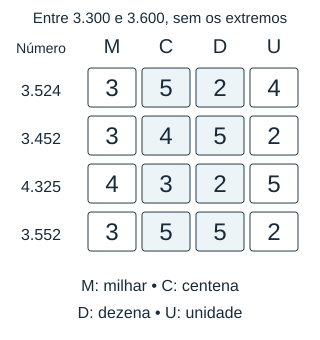

# Revisão pedagógica — Sistema de Numeração

## Escopo e resultado

Foram conferidas as 20 questões SN-01 a SN-20 do banco inédito. **20 possuem quatro alternativas e uma única resposta correta; 12 continuam visualmente apoiadas.** Habilidades, assuntos, dificuldades, IDs, dados numéricos e letras dos gabaritos foram preservados.

As questões modificadas foram **SN-01 a SN-12 e SN-17**: as 12 primeiras tiveram seus recursos revistos; SN-03/07/10/12 receberam também as correções de enunciado solicitadas, e SN-17 teve a justificativa da alternativa A e a resolução corrigidas. SN-11 recebeu explicitação da regra no ponto médio. As outras sete questões foram revalidadas sem mudança de conteúdo.

## Avaliação individual dos recursos

| Questão | Recurso atual | Motivo pedagógico |
| --- | --- | --- |
| SN-01 | Painel de contagem e escala de centenas | Fonte da leitura arredondada e indicação do passo de 100; sem mostrar o intervalo da resposta. |
| SN-02 | Sequência de etiquetas numeradas | Permite contar os extremos inclusivos e considerar o aviso de cancelamento; não inventa quais fichas foram canceladas. |
| SN-03 | Painel de acessos abreviado | Apresenta 2,4 k como dado a interpretar, com legenda k=mil; contexto e unidade agora coincidem. |
| SN-04 | Etiqueta e reta com extremos abertos | Mostra a lacuna e as posições de 640 a 650, deixando explícita a exclusão dos extremos. |
| SN-05 | Cartões de algarismos e espaços por ordem | Organiza os algarismos e as quatro posições vazias sob o limite de 6.000; não oferece uma combinação pronta. |
| SN-06 | Quadros antes/depois e setas de troca | Relaciona posições C e U sem escrever o número resultante; M e D permanecem fixos. |
| SN-07 | Tabela comparativa reformulada | Cada intervalo usa “de … a …”, com o primeiro e o último registro incluídos. |
| SN-08 | Tabela comparativa mantida e formatada | Relaciona contagem exata e valor publicado lado a lado; cabeçalhos e milhares têm apresentação mais clara. |
| SN-09 | Duas escalas com ampliações diferentes | Diferencia passo de 100 e de 1.000; não confunde leituras aproximadas com limites reais. |
| SN-10 | Diagrama de folhas com frente/verso | Agrupa 41/42, 43/44 e 79/80 em folhas completas, com reticências entre elas; não informa o total de folhas. |
| SN-11 | Anúncio e escala de dezenas de milhar | Apresenta 70.000 e marcas vizinhas/médias, apoiando a interpretação do arredondamento; valores intermediários ficam sem rótulo. |
| SN-12 | Quadros alinhados de valor posicional | Alinha M, C, D e U para comparar centenas e dezenas em todos os candidatos; nenhuma linha é marcada como correta. |

**Substituições:** as tabelas de SN-01/02/03/04/05/06/09/10/11/12 foram substituídas
por dez SVG. As tabelas de SN-07/08 foram mantidas como recursos de comparação,
com estrutura e formatação aprimoradas. Não foram acrescentados elementos
meramente decorativos nem alterados os dados das questões.

Os SVG possuem descrições acessíveis, fundo branco para contraste, `viewBox` e
CSS associado que permite largura fluida com altura proporcional. Foram
renderizados e inspecionados em largura de **320 pixels**. A inspeção levou à
correção de uma legenda sobreposta e à substituição de um caractere de
reticências que não renderizava por três pontos desenhados. Isso não constitui
um teste de interface ou de aparelho real; a interface continua inexistente.

## Conferências matemáticas e de preservação

- As 20 respostas foram recalculadas pelos modelos, com quatro alternativas e uma única correta em cada questão.
- SN-03 continua representando 2,4 milhares = 2.400 acessos; a inconsistência com distâncias foi removida.
- SN-07 inclui ambos os extremos dos intervalos; Ana recebe 100 registros.
- SN-10 agrupa 40 páginas em 20 folhas completas, duas páginas em cada folha.
- SN-12 compara os algarismos, e não os valores totais das ordens: 5>2 em 3.524.
- SN-17 usa os valores específicos 18.001 e 18.999 como contraexemplos. Não afirma que todos os valores possíveis estejam separados por mais de 200.
- Os números e espaçamentos das retas, as etiquetas, os quadros de ordens e os pares frente/verso foram conferidos contra os dados do banco.
- As classificações e as letras de gabarito permanecem iguais às da versão anterior.
- Os quatro arquivos dos outros assuntos, seus recursos e os bancos anteriores foram comparados por SHA-256 e permanecem inalterados. As seções dos outros assuntos no caderno foram preservadas literalmente.

O validador comum recebeu suporte apenas para os recursos revisados de SN. A
execução de conferência do banco completo foi uma leitura de verificação, sem
modificar questões dos outros assuntos. O resultado continua sendo 100 questões
matematicamente válidas e 60 visualmente apoiadas. Esta revisão não registra
aprovação final do usuário sobre os novos desenhos; o material atualizado fica
disponível para conferência pedagógica.

## Versões completas das cinco questões corrigidas

### MFC6-B1-I-SN-03 — Leitura com unidade abreviada

**Habilidade:** Relacionar abreviação de milhares ao valor posicional.

**Dificuldade:** facil

O portal de um projeto escolar mostra a quantidade de acessos usando a letra k para indicar mil. Observe o painel. Qual quantidade de acessos ele apresenta?

**Recurso visual:** Contador de acessos ao portal mostrando 2,4 k. A legenda informa que k indica mil. A quantidade por extenso ou em unidades não aparece no painel.

- **A)** 24 acessos.
- **B)** 2.040 acessos.
- **C)** 2.400 acessos.
- **D)** 24.000 acessos.

**Gabarito: C.**

**Resolução comentada:** A unidade k significa mil: 2,4 milhares são 2 milhares e 4 décimos de milhar, isto é, 2.400. Não são 24 nem 2.040.

### MFC6-B1-I-SN-07 — Blocos numerados do cadastro

**Habilidade:** Comparar cardinalidades de intervalos naturais com extremos inclusivos.

**Dificuldade:** media

Para revisar um cadastro, cada voluntário recebe um intervalo de números. O primeiro e o último registro de cada intervalo também devem ser revisados. Observe a tabela. Qual voluntário recebeu exatamente cem registros?

**Recurso visual:** Tabela de intervalos inclusivos: Ana, de 1.200 a 1.299; Beto, de 1.300 a 1.400; Cris, de 1.401 a 1.499; Dani, de 1.500 a 1.601. Os dois extremos pertencem a cada intervalo.

| Voluntário | Intervalo de registros |
| --- | --- |
| Ana | de 1.200 a 1.299 |
| Beto | de 1.300 a 1.400 |
| Cris | de 1.401 a 1.499 |
| Dani | de 1.500 a 1.601 |

- **A)** Beto.
- **B)** Cris.
- **C)** Ana.
- **D)** Dani.

**Gabarito: C.**

**Resolução comentada:** Ana recebeu 1.299 − 1.200 + 1 = 100. Beto recebeu 101, Cris 99 e Dani 102. Contar apenas a diferença deixa de incluir um extremo.

### MFC6-B1-I-SN-10 — Numeração dos dois lados

**Habilidade:** Relacionar intervalo inclusivo a agrupamentos de duas páginas por folha.

**Dificuldade:** media

Uma encadernadora numera todas as páginas de um caderno, inclusive as páginas em branco. O trecho mostrado é formado apenas por folhas completas: cada folha tem uma página na frente e outra no verso. A primeira folha começa na página 41 e a última termina na página 80. Observe o esquema das folhas. Quantas folhas completas há nesse trecho?

**Recurso visual:** Diagrama de folhas completas: primeira folha com frente 41 e verso 42; folha seguinte com frente 43 e verso 44; reticências indicam continuação; última folha com frente 79 e verso 80. O total de folhas não está escrito.

- **A)** 40 folhas.
- **B)** 20 folhas.
- **C)** 19 folhas.
- **D)** 39 folhas.

**Gabarito: B.**

**Resolução comentada:** O trecho inclui as páginas de 41 a 80: são 80 − 41 + 1 = 40 páginas. Como todas pertencem a folhas completas, com duas páginas por folha, há 40 ÷ 2 = 20 folhas. A primeira reúne as páginas 41 e 42; a última, 79 e 80.

### MFC6-B1-I-SN-12 — Identificadores com regra dupla

**Habilidade:** Combinar desigualdade estrita entre ordens e intervalo de valores.

**Dificuldade:** dificil

Para identificar uma cadeira, o algarismo na posição das centenas deve ser maior que o algarismo na posição das dezenas. Além disso, o número deve ser maior que 3.300 e menor que 3.600. Observe os quadros de ordens. Qual identificador atende às duas condições?

**Recurso visual:** Quatro quadros de ordens, para 3.524, 3.452, 4.325 e 3.552, alinhando M, C, D e U. As colunas C e D têm o mesmo destaque para comparar seus algarismos. O intervalo permitido, sem os extremos, é de 3.300 a 3.600. Nenhuma linha está indicada como correta.

- **A)** 3.452.
- **B)** 4.325.
- **C)** 3.552.
- **D)** 3.524.

**Gabarito: D.**

**Resolução comentada:** No número 3.524, o algarismo das centenas é 5 e o das dezenas é 2: 5 é maior que 2. O número também é maior que 3.300 e menor que 3.600. Em 3.452, 4 não é maior que 5; em 3.552, os dois algarismos são iguais a 5. O número 4.325 está fora do intervalo. Portanto, somente 3.524 atende às duas condições.

### MFC6-B1-I-SN-17 — Estimativa que cabe no intervalo

**Habilidade:** Avaliar se a informação disponível garante a precisão exigida.

**Dificuldade:** media

Uma contagem exata está entre 18.000 e 19.000, sem incluir esses limites. Um relatório dá uma estimativa que deve ter diferença menor que 100 para qualquer contagem possível. É possível escolher uma única estimativa inteira com essa garantia? Escolha a alternativa que responde à situação.

- **A)** Não; os valores 18.001 e 18.999, ambos possíveis, não podem ficar a menos de 100 de uma mesma estimativa.
- **B)** Sim; qualquer estimativa de 18 mil atende.
- **C)** Sim; 18.500 fica a menos de 100 de qualquer valor da faixa.
- **D)** Sim; 19.000 é sempre a aproximação mais próxima.

**Gabarito: A.**

**Resolução comentada:** Não. Considere duas contagens possíveis: 18.001 e 18.999. Para ficar a menos de 100 de 18.001, uma estimativa inteira deve estar de 17.902 a 18.100. Para ficar a menos de 100 de 18.999, deve estar de 18.900 a 19.098. Esses intervalos não têm nenhum número em comum. Assim, nenhuma estimativa única atende à precisão exigida para todas as contagens possíveis. Isso não significa que todas as contagens estejam distantes entre si: há também contagens consecutivas no intervalo.

## Arquivos atualizados

- [Banco de Sistema de Numeração](sistema-numeracao.json).
- [Caderno de revisão, seção de SN](revisao-pedagogica.md).
- Dez SVG novos na pasta `recursos/`.
- Validador e resultado de conferência, além dos índices e relatório compartilhados para refletir somente esta revisão.

Nenhuma interface foi programada. O Blogger e outros repositórios não foram alterados.
