# Caderno de revisão pedagógica — banco inédito

100 questões autorais para o 6º ano. As resoluções e justificativas de distratores são material do revisor, não devem aparecer antes da finalização no futuro simulado. A revisão das 100 questões foi concluída pelo usuário; nenhuma foi publicada.

## Sistema de numeração

### MFC6-B1-I-SN-01 — O arredondamento do painel

**Dificuldade:** facil. **Habilidade:** Interpretar o intervalo de valores que pode originar um arredondamento.

Um painel ambiental mostra a quantidade de sementes por centenas, arredondando para a centena mais próxima; a partir de 50 unidades, arredonda para cima. Observe o painel e a escala de centenas. Qual quantidade real poderia ter produzido o valor mostrado?

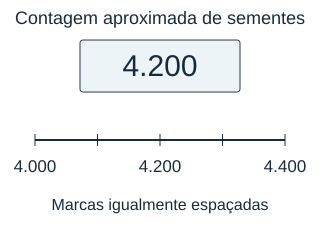

**Descrição do recurso visual:** Painel com 4.200 sementes. A escala abaixo tem marcas igualmente espaçadas em 4.000, 4.100, 4.200, 4.300 e 4.400; apenas 4.000, 4.200 e 4.400 estão escritos. A escala indica o passo de uma centena.

- **A)** 4.176 sementes.
- **B)** 4.149 sementes.
- **C)** 4.250 sementes.
- **D)** 4.301 sementes.

**Gabarito: A.** Os inteiros de 4.150 a 4.249 arredondam para 4.200. Entre as opções, apenas 4.176 pertence a esse intervalo.

**Distratores:**

- B: Incluir um valor abaixo do limite de arredondamento.
- C: Incluir o limite que já arredonda para 4.300.
- D: Confundir proximidade com a regra da centena.

### MFC6-B1-I-SN-02 — Remessa sem lacunas

**Dificuldade:** facil. **Habilidade:** Contar naturais em um intervalo inclusivo e considerar exclusões.

Um museu numera fichas consecutivamente, incluindo a primeira e a última. A contagem automática ignora fichas canceladas. Observe a sequência de fichas e o aviso de cancelamento. Quantas fichas válidas há na remessa?

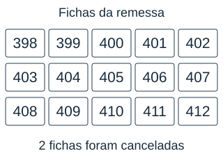

**Descrição do recurso visual:** Quinze etiquetas dispostas em três linhas de cinco, numeradas consecutivamente de 398 a 412. Um aviso informa que duas fichas foram canceladas, sem indicar quais foram.

- **A)** 12 fichas.
- **B)** 13 fichas.
- **C)** 15 fichas.
- **D)** 16 fichas.

**Gabarito: B.** Há 412 − 398 + 1 = 15 números, porque os dois extremos contam. Retirando duas fichas canceladas, restam 13 válidas.

**Distratores:**

- A: Não contar um dos extremos.
- C: Ignorar os cancelamentos.
- D: Acrescentar em vez de retirar fichas canceladas.

### MFC6-B1-I-SN-03 — Leitura com unidade abreviada

**Dificuldade:** facil. **Habilidade:** Relacionar abreviação de milhares ao valor posicional.

O portal de um projeto escolar mostra a quantidade de acessos usando a letra k para indicar mil. Observe o painel. Qual quantidade de acessos ele apresenta?

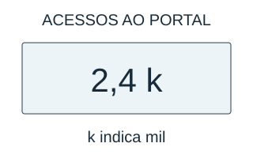

**Descrição do recurso visual:** Contador de acessos ao portal mostrando 2,4 k. A legenda informa que k indica mil. A quantidade por extenso ou em unidades não aparece no painel.

- **A)** 24 acessos.
- **B)** 2.040 acessos.
- **C)** 2.400 acessos.
- **D)** 24.000 acessos.

**Gabarito: C.** A unidade k significa mil: 2,4 milhares são 2 milhares e 4 décimos de milhar, isto é, 2.400. Não são 24 nem 2.040.

**Distratores:**

- A: Retirar a vírgula sem considerar a unidade.
- B: Interpretar décimos de milhar como dezenas.
- D: Multiplicar por dez além do necessário.

### MFC6-B1-I-SN-04 — Etiqueta parcialmente apagada

**Dificuldade:** facil. **Habilidade:** Reconstruir algarismo por restrições de ordenação.

Uma etiqueta de arquivo mostra 6□2. A regra de organização exige que ela fique depois do limite inferior e antes do superior, sem incluir esses limites. Observe a etiqueta e a reta numérica. Qual algarismo completa a etiqueta?

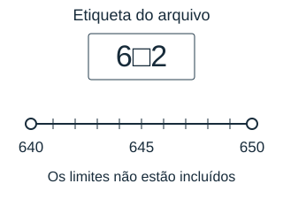

**Descrição do recurso visual:** Etiqueta 6□2 e reta de 640 a 650, com marcas de uma unidade e 645 no meio. Os extremos 640 e 650 aparecem com círculos vazios para indicar que não pertencem ao intervalo.

- **A)** 3.
- **B)** 5.
- **C)** 6.
- **D)** 4.

**Gabarito: D.** Entre 640 e 650, o único número da forma 6□2 é 642, logo a dezena é 4. 632 fica antes; 652 e 662 ficam depois.

**Distratores:**

- A: Escolher a dezena anterior ao intervalo.
- B: Desconsiderar o limite superior.
- C: Copiar a centena na ordem das dezenas.

### MFC6-B1-I-SN-05 — Maior número sem ultrapassar o teto

**Dificuldade:** media. **Habilidade:** Escolher uma estratégia de maximização sob limite e sem repetição.

Um equipamento aceita identificadores de quatro algarismos diferentes. Deve-se usar cada algarismo disponível uma única vez. Observe os algarismos disponíveis e os espaços do identificador. Qual é o maior identificador permitido abaixo do teto?

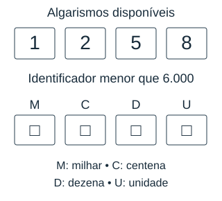

**Descrição do recurso visual:** Quatro cartões com os algarismos 1, 2, 5 e 8. Abaixo há quatro espaços vazios nas posições M, C, D e U. Uma legenda indica milhar, centena, dezena e unidade. O limite é menor que 6.000.

- **A)** 5.821.
- **B)** 8.521.
- **C)** 5.812.
- **D)** 5.521.

**Gabarito: A.** O primeiro algarismo não pode ser 8. Usamos 5 para maximizar os milhares e depois 8, 2 e 1 em ordem decrescente: 5.821, ainda abaixo de 6.000.

**Distratores:**

- B: Maximizar sem respeitar o teto.
- C: Não maximizar dezenas e unidades.
- D: Repetir um algarismo que só pode ser usado uma vez.

### MFC6-B1-I-SN-06 — Troca de ordens no formulário

**Dificuldade:** media. **Habilidade:** Avaliar o efeito de uma permutação de algarismos no valor do número.

Ao corrigir um cadastro de coleção, a equipe trocou de posição o algarismo das centenas e o das unidades, mantendo os demais. Observe os quadros de ordens e a troca indicada. Qual foi a variação do número registrado?

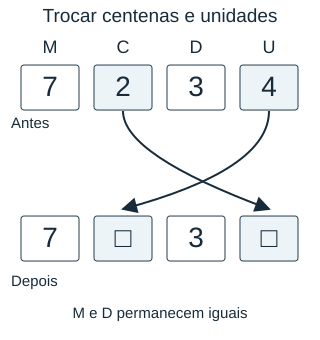

**Descrição do recurso visual:** Quadro inicial com M=7, C=2, D=3 e U=4. Setas ligam C a U e U a C. No quadro seguinte, M=7 e D=3 permanecem escritos; as posições C e U ficam vazias para completar a troca.

- **A)** Aumentou 2.
- **B)** Aumentou 198.
- **C)** Diminuiu 198.
- **D)** Aumentou 200.

**Gabarito: B.** O registro 7.234 passa a 7.432. A variação é 7.432 − 7.234 = 198; o valor aumenta porque o 4 passou às centenas.

**Distratores:**

- A: Comparar apenas os algarismos trocados.
- C: Inverter a direção da mudança.
- D: Ignorar a diferença das unidades.

### MFC6-B1-I-SN-07 — Blocos numerados do cadastro

**Dificuldade:** media. **Habilidade:** Comparar cardinalidades de intervalos naturais com extremos inclusivos.

Para revisar um cadastro, cada voluntário recebe um intervalo de números. O primeiro e o último registro de cada intervalo também devem ser revisados. Observe a tabela. Qual voluntário recebeu exatamente cem registros?

| Voluntário | Intervalo de registros |
| --- | --- |
| Ana | de 1.200 a 1.299 |
| Beto | de 1.300 a 1.400 |
| Cris | de 1.401 a 1.499 |
| Dani | de 1.500 a 1.601 |

**Descrição do recurso visual:** Tabela de intervalos inclusivos: Ana, de 1.200 a 1.299; Beto, de 1.300 a 1.400; Cris, de 1.401 a 1.499; Dani, de 1.500 a 1.601. Os dois extremos pertencem a cada intervalo.

- **A)** Beto.
- **B)** Cris.
- **C)** Ana.
- **D)** Dani.

**Gabarito: C.** Ana recebeu 1.299 − 1.200 + 1 = 100. Beto recebeu 101, Cris 99 e Dani 102. Contar apenas a diferença deixa de incluir um extremo.

**Distratores:**

- A: Considerar a diferença 100 como contagem completa.
- B: Confundir 99 com cem por proximidade dos limites.
- D: Ignorar os dois registros que excedem cem.

### MFC6-B1-I-SN-08 — Registro com arredondamento correto

**Dificuldade:** media. **Habilidade:** Verificar coerência entre números exatos e aproximações publicadas.

Um observatório publica quantidades arredondadas ao milhar mais próximo. A conferência procura uma publicação incompatível com essa regra. Consulte os dados da tabela. Qual publicação deve ser corrigida?

| Registro | Contagem exata | Valor publicado |
| --- | --- | --- |
| P | 12.499 | 12.000 |
| Q | 12.500 | 13.000 |
| R | 13.990 | 13.000 |
| S | 14.001 | 14.000 |

**Descrição do recurso visual:** Tabela comparativa: P, 12.499 e 12.000; Q, 12.500 e 13.000; R, 13.990 e 13.000; S, 14.001 e 14.000. As colunas distinguem contagem exata e valor publicado, sem indicar qual é incorreto.

- **A)** Registro P.
- **B)** Registro Q.
- **C)** Registro S.
- **D)** Registro R.

**Gabarito: D.** 13.990 está mais perto de 14.000 que de 13.000, então R está errado. 12.499 arredonda para 12.000; 12.500 para 13.000; 14.001 para 14.000.

**Distratores:**

- A: Arredondar para cima qualquer valor que tenha centenas.
- B: Não aplicar a regra de subir no meio do intervalo.
- C: Confundir presença de unidades com mudança de milhar.

### MFC6-B1-I-SN-09 — Duas telas, um intervalo

**Dificuldade:** dificil. **Habilidade:** Cruzar restrições de duas precisões de arredondamento.

Duas telas independentes arredondam a mesma contagem: uma à centena e outra ao milhar. Nos pontos médios, ambas arredondam para cima. Observe as leituras e os passos das duas escalas; elas estão desenhadas com ampliações diferentes. Qual opção apresenta todos os valores inteiros compatíveis com as duas telas?

**Descrição do recurso visual:** Duas escalas com ampliações diferentes. A tela à centena indica 8.700 e sua reta tem marcas de 100 em 100, de 8.500 a 8.900. A tela ao milhar indica 9.000 e sua reta marca 8.000, 9.000 e 10.000. As leituras são aproximações, não limites da contagem real.

- **A)** De 8.650 a 8.749.
- **B)** De 8.500 a 9.499.
- **C)** De 8.700 a 9.000.
- **D)** De 8.650 a 8.750.

**Gabarito: A.** A primeira tela admite 8.650 a 8.749. A segunda admite 8.500 a 9.499. A interseção é 8.650 a 8.749, incluindo ambos os extremos.

**Distratores:**

- B: Usar apenas a tela menos precisa.
- C: Tratar valores arredondados como extremos reais.
- D: Incluir o valor que arredonda para 8.800.

### MFC6-B1-I-SN-10 — Numeração dos dois lados

**Dificuldade:** media. **Habilidade:** Relacionar intervalo inclusivo a agrupamentos de duas páginas por folha.

Uma encadernadora numera todas as páginas de um caderno, inclusive as páginas em branco. O trecho mostrado é formado apenas por folhas completas: cada folha tem uma página na frente e outra no verso. A primeira folha começa na página 41 e a última termina na página 80. Observe o esquema das folhas. Quantas folhas completas há nesse trecho?

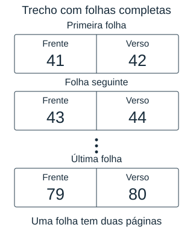

**Descrição do recurso visual:** Diagrama de folhas completas: primeira folha com frente 41 e verso 42; folha seguinte com frente 43 e verso 44; reticências indicam continuação; última folha com frente 79 e verso 80. O total de folhas não está escrito.

- **A)** 40 folhas.
- **B)** 20 folhas.
- **C)** 19 folhas.
- **D)** 39 folhas.

**Gabarito: B.** O trecho inclui as páginas de 41 a 80: são 80 − 41 + 1 = 40 páginas. Como todas pertencem a folhas completas, com duas páginas por folha, há 40 ÷ 2 = 20 folhas. A primeira reúne as páginas 41 e 42; a última, 79 e 80.

**Distratores:**

- A: Confundir página com folha.
- C: Não incluir a página inicial e truncar a divisão.
- D: Usar a diferença entre extremos como número de folhas.

### MFC6-B1-I-SN-11 — O limite de uma contagem aproximada

**Dificuldade:** media. **Habilidade:** Inferir um limite inferior a partir de uma aproximação grosseira.

Um cartaz anuncia uma quantidade aproximada de visitantes, arredondada à dezena de milhar mais próxima. No meio entre duas dezenas de milhar, o arredondamento é para cima. Observe o anúncio e a escala. Qual é a menor contagem inteira possível que ainda produz o anúncio?

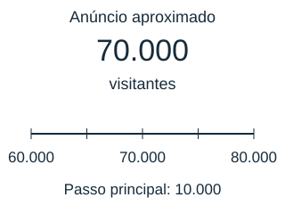

**Descrição do recurso visual:** Anúncio de 70.000 visitantes e reta com 60.000, 70.000 e 80.000 como marcas principais. Há uma marca menor no meio de cada intervalo; as marcas intermediárias não têm valores escritos.

- **A)** 69.999.
- **B)** 60.000.
- **C)** 65.000.
- **D)** 70.000.

**Gabarito: C.** Ao arredondar à dezena de milhar, 65.000 já sobe para 70.000. Valores menores que 65.000 ficam mais próximos de 60.000. O mínimo é 65.000.

**Distratores:**

- A: Supor que apenas o predecessor arredonda para o anúncio.
- B: Confundir vizinho inferior com limite do intervalo.
- D: Tratar aproximação como valor exato.

### MFC6-B1-I-SN-12 — Identificadores com regra dupla

**Dificuldade:** dificil. **Habilidade:** Combinar desigualdade estrita entre ordens e intervalo de valores.

Para identificar uma cadeira, o algarismo na posição das centenas deve ser maior que o algarismo na posição das dezenas. Além disso, o número deve ser maior que 3.300 e menor que 3.600. Observe os quadros de ordens. Qual identificador atende às duas condições?

**Descrição do recurso visual:** Quatro quadros de ordens, para 3.524, 3.452, 4.325 e 3.552, alinhando M, C, D e U. As colunas C e D têm o mesmo destaque para comparar seus algarismos. O intervalo permitido, sem os extremos, é de 3.300 a 3.600. Nenhuma linha está indicada como correta.

- **A)** 3.452.
- **B)** 4.325.
- **C)** 3.552.
- **D)** 3.524.

**Gabarito: D.** No número 3.524, o algarismo das centenas é 5 e o das dezenas é 2: 5 é maior que 2. O número também é maior que 3.300 e menor que 3.600. Em 3.452, 4 não é maior que 5; em 3.552, os dois algarismos são iguais a 5. O número 4.325 está fora do intervalo. Portanto, somente 3.524 atende às duas condições.

**Distratores:**

- A: Verificar intervalo, mas ignorar que 4 não é maior que 5.
- B: Verificar ordens, mas ignorar intervalo.
- C: Aceitar igualdade quando se exige maior.

### MFC6-B1-I-SN-13 — Consecutivos na parada

**Dificuldade:** facil. **Habilidade:** Reconhecer simetria em uma sequência de naturais.

Um contador mostra três números consecutivos. O do meio é 9.999. Sem somar os três um a um, qual média deve ser registrada? Escolha a alternativa que responde à situação.

- **A)** 9.999.
- **B)** 10.000.
- **C)** 9.998.
- **D)** 29.997.

**Gabarito: A.** Em três números consecutivos igualmente espaçados, os extremos estão uma unidade abaixo e acima do central; essas diferenças se compensam. A média é 9.999.

**Distratores:**

- B: Usar o sucessor como média.
- C: Usar o antecessor como média.
- D: Confundir soma com média.

### MFC6-B1-I-SN-14 — Zero à esquerda de um protocolo

**Dificuldade:** facil. **Habilidade:** Distinguir preenchimento de formato e alteração do valor posicional.

Um sistema de protocolos usa seis posições e completa à esquerda com zeros. O protocolo numérico é 4.812. Qual texto de seis posições identifica o mesmo protocolo? Escolha a alternativa que responde à situação.

- **A)** 048120.
- **B)** 004812.
- **C)** 040812.
- **D)** 481200.

**Gabarito: B.** Completar com dois zeros à esquerda produz 004812. Zeros à esquerda não mudam o valor; colocar zeros no meio ou no fim muda o número.

**Distratores:**

- A: Colocar um zero à direita muda o valor.
- C: Inserir zero no interior altera as ordens.
- D: Completar o número à direita.

### MFC6-B1-I-SN-15 — Escolha de tolerância

**Dificuldade:** media. **Habilidade:** Interpretar distância entre naturais atravessando um milhar.

Uma medição por unidades só pode diferir da referência por no máximo 2 unidades. A referência é 3.998. Qual registro atende à tolerância? Escolha a alternativa que responde à situação.

- **A)** 4.001.
- **B)** 3.995.
- **C)** 4.000.
- **D)** 4.010.

**Gabarito: C.** São aceitos os valores de 3.996 a 4.000. A passagem de milhar não impede que 4.000 esteja a apenas duas unidades de 3.998.

**Distratores:**

- A: Não contar corretamente a passagem de milhar.
- B: Aceitar distância de três unidades.
- D: Considerar apenas a proximidade do milhar.

### MFC6-B1-I-SN-16 — Faixa de busca em um catálogo

**Dificuldade:** media. **Habilidade:** Identificar uma faixa de agrupamento por milhares.

Para localizar o número 56.204, um catálogo separa registros em blocos de mil números: 0–999, 1.000–1.999 e assim por diante. Em qual bloco ele está? Escolha a alternativa que responde à situação.

- **A)** 55.000–55.999.
- **B)** 56.200–56.299.
- **C)** 56.204–57.203.
- **D)** 56.000–56.999.

**Gabarito: D.** O bloco começa em 56.000 e termina em 56.999. O grupo 56 indica os milhares; 204 é a posição dentro desse bloco.

**Distratores:**

- A: Escolher o bloco anterior.
- B: Usar centenas em vez de milhares.
- C: Iniciar uma faixa no registro procurado em vez da regra do catálogo.

### MFC6-B1-I-SN-17 — Estimativa que cabe no intervalo

**Dificuldade:** media. **Habilidade:** Avaliar se a informação disponível garante a precisão exigida.

Uma contagem exata está entre 18.000 e 19.000, sem incluir esses limites. Um relatório dá uma estimativa que deve ter diferença menor que 100 para qualquer contagem possível. É possível escolher uma única estimativa inteira com essa garantia? Escolha a alternativa que responde à situação.

- **A)** Não; os valores 18.001 e 18.999, ambos possíveis, não podem ficar a menos de 100 de uma mesma estimativa.
- **B)** Sim; qualquer estimativa de 18 mil atende.
- **C)** Sim; 18.500 fica a menos de 100 de qualquer valor da faixa.
- **D)** Sim; 19.000 é sempre a aproximação mais próxima.

**Gabarito: A.** Não. Considere duas contagens possíveis: 18.001 e 18.999. Para ficar a menos de 100 de 18.001, uma estimativa inteira deve estar de 17.902 a 18.100. Para ficar a menos de 100 de 18.999, deve estar de 18.900 a 19.098. Esses intervalos não têm nenhum número em comum. Assim, nenhuma estimativa única atende à precisão exigida para todas as contagens possíveis. Isso não significa que todas as contagens estejam distantes entre si: há também contagens consecutivas no intervalo.

**Distratores:**

- B: Confundir faixa de milhar com erro menor que cem.
- C: Verificar só valores próximos do centro.
- D: Ignorar contagens próximas de 18.000.

### MFC6-B1-I-SN-18 — Leitura de marco incompleto

**Dificuldade:** media. **Habilidade:** Distinguir ordenação de texto e ordenação pelo valor de números naturais.

As fotos de um experimento receberam nomes 2.png, 11.png e 3.png. A ordem alfabética coloca 11.png antes de 2.png. Qual sequência corresponde à ordem numérica de realização do experimento?

- **A)** 11.png, 2.png, 3.png.
- **B)** 2.png, 3.png, 11.png.
- **C)** 3.png, 2.png, 11.png.
- **D)** 11.png, 3.png, 2.png.

**Gabarito: B.** A ordem numérica é 2,3,11. Comparar só o primeiro caractere põe 11 antes de 2, mas um número de duas ordens pode ser maior que os de uma ordem. A sequência correta é 2.png, 3.png, 11.png.

**Distratores:**

- A: Usar ordenação alfabética.
- C: Inverter os valores de uma ordem.
- D: Usar ordem decrescente.

### MFC6-B1-I-SN-19 — Arquivos em lotes sobrepostos

**Dificuldade:** dificil. **Habilidade:** Contar intervalos com sobreposição sem duplicar elementos.

Dois lotes de registros numerados de 200 a 249 e de 240 a 289 serão unidos. Os números repetidos devem aparecer apenas uma vez. Quantos números diferentes haverá? Escolha a alternativa que responde à situação.

- **A)** 100.
- **B)** 89.
- **C)** 90.
- **D)** 80.

**Gabarito: C.** Cada lote tem 50 números. Os dez números de 240 a 249 estão em ambos. A união tem 50 + 50 − 10 = 90, ou os números de 200 a 289.

**Distratores:**

- A: Somar lotes sem retirar duplicatas.
- B: Não incluir um extremo da união.
- D: Retirar a interseção duas vezes.

### MFC6-B1-I-SN-20 — Última etiqueta de três algarismos

**Dificuldade:** dificil. **Habilidade:** Maximizar e minimizar números sob restrição de ordem inicial.

Uma máquina imprime números de três algarismos usando 0, 4 e 7, cada um exatamente uma vez. O primeiro algarismo não pode ser zero. Qual é a diferença entre o maior e o menor número que ela pode imprimir? Escolha a alternativa que responde à situação.

- **A)** 693.
- **B)** 270.
- **C)** 297.
- **D)** 333.

**Gabarito: D.** Os válidos são 407, 470, 704 e 740. O maior é 740 e o menor é 407: diferença 333. O registro 047 não é um número de três algarismos.

**Distratores:**

- A: Aceitar 047 como número de três algarismos.
- B: Usar 470 como mínimo.
- C: Usar 704 como máximo.

## Operações com números naturais

### MFC6-B1-I-ON-01 — Tarifa do armário

**Dificuldade:** facil. **Habilidade:** Comparar custos de estratégias de uso e quantificar economia.

Um centro esportivo oferece um plano diário e um pacote para guardar equipamentos. A pessoa usará o serviço por quatro dias. O pacote cobre todos esses quatro dias, sem cobrança diária adicional. Observe as ofertas no esquema. Qual plano custa menos e qual é a economia?

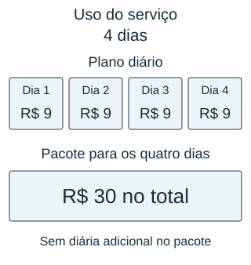

**Descrição do recurso visual:** Quatro espaços de diária, um para cada dia de uso, com R$ 9 em cada. Uma faixa de pacote cobre os mesmos quatro dias por R$ 30 no total, sem cobrança diária adicional. O total do plano diário não está calculado.

- **A)** Pacote: R$ 30,00; economia de R$ 6,00.
- **B)** Diário: R$ 9,00; economia de R$ 21,00.
- **C)** Pacote: R$ 30,00; economia de R$ 9,00.
- **D)** Diário: R$ 36,00; economia de R$ 6,00.

**Gabarito: A.** O plano diário custa 4 × 9 = 36 reais para os quatro dias. O pacote cobre o mesmo período por 30 reais, sem cobrança diária adicional. A economia é 36 − 30 = 6 reais. Comparar apenas o preço de um dia com o pacote não compara períodos iguais.

**Distratores:**

- B: Comparar apenas um dia.
- C: Confundir preço diário com economia.
- D: Escolher o plano mais caro.

### MFC6-B1-I-ON-02 — Pontos com penalidade

**Dificuldade:** facil. **Habilidade:** Modelar ganhos e perdas com multiplicação e subtração.

Uma oficina de programação criou uma regra de pontuação: acertos dão pontos e tentativas inválidas retiram pontos. Observe os grupos de acertos e penalidades no esquema. Qual é o saldo da rodada?

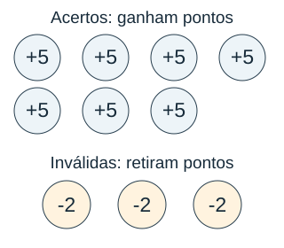

**Descrição do recurso visual:** Sete círculos de acerto mostram +5 cada um. Abaixo, três círculos de tentativa inválida mostram -2 cada um. Os sinais e os títulos distinguem ganhos e perdas; o saldo não está escrito.

- **A)** 35 pontos.
- **B)** 29 pontos.
- **C)** 41 pontos.
- **D)** 32 pontos.

**Gabarito: B.** Os acertos geram 35 pontos; as três penalidades retiram 6. O saldo é 29, não 35 nem 41.

**Distratores:**

- A: Ignorar penalidades.
- C: Somar penalidades.
- D: Retirar um ponto por inválida em vez de dois.

### MFC6-B1-I-ON-03 — Produção com parada para manutenção

**Dificuldade:** facil. **Habilidade:** Separar tempo produtivo e tempo indisponível antes de calcular capacidade.

Uma prensa produz peças em ritmo constante enquanto está funcionando. Dentro da janela de trabalho, ela ficará parada para uma manutenção. Observe o esquema, que reúne o tempo total, a parada e o ritmo de produção. Quantas peças podem ficar prontas nessa janela?

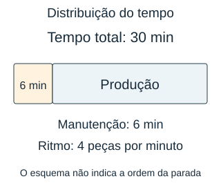

**Descrição do recurso visual:** Barra de 30 minutos dividida em uma parte de manutenção de 6 minutos e uma parte de produção sem duração escrita. O ritmo é quatro peças por minuto. A barra agrupa durações, sem indicar em qual momento ocorreu a parada.

- **A)** 120 peças.
- **B)** 114 peças.
- **C)** 96 peças.
- **D)** 24 peças.

**Gabarito: C.** Só 24 dos 30 minutos produzem peças. A capacidade é 24×4=96; não se deve multiplicar os minutos de manutenção.

**Distratores:**

- A: Ignorar manutenção.
- B: Retirar seis peças em vez de seis minutos de produção.
- D: Responder o tempo disponível como quantidade.

### MFC6-B1-I-ON-04 — Contagem sem repetir participantes

**Dificuldade:** facil. **Habilidade:** Contar união de grupos com interseção.

Dois clubes escolares têm integrantes em comum. A recepção deve preparar uma única identificação para cada pessoa. Observe o diagrama: os totais de cada clube já incluem quem participa dos dois. Quantas identificações são necessárias?

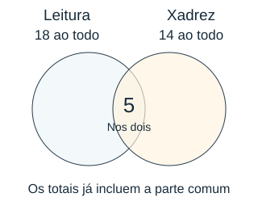

**Descrição do recurso visual:** Dois círculos parcialmente sobrepostos representam os clubes. Leitura tem 18 integrantes ao todo e Xadrez, 14 ao todo; esses totais incluem os cinco participantes da região comum. As quantidades exclusivas não estão calculadas.

- **A)** 32.
- **B)** 22.
- **C)** 37.
- **D)** 27.

**Gabarito: D.** Ao somar 18 e 14, os cinco integrantes dos dois clubes são contados duas vezes. Retirando uma cópia de cada, são 27 pessoas distintas.

**Distratores:**

- A: Contar os integrantes comuns duas vezes.
- B: Retirar os cinco integrantes comuns dos dois grupos.
- C: Somar a interseção como grupo adicional.

### MFC6-B1-I-ON-05 — Borda de uma placa

**Dificuldade:** media. **Habilidade:** Contar uma borda sem duplicar seus cantos.

Uma placa retangular tem quadradinhos em linhas e colunas. Só os da borda serão pintados; cada canto conta uma vez. Observe a grade de seis linhas e oito colunas. Quantos quadradinhos serão pintados?

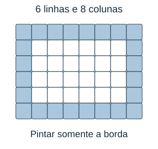

**Descrição do recurso visual:** Grade de seis linhas e oito colunas. As células da borda estão destacadas, e as internas ficam brancas. Cada canto é uma única célula. As dimensões estão indicadas sem calcular a quantidade de células da borda.

- **A)** 24.
- **B)** 28.
- **C)** 48.
- **D)** 20.

**Gabarito: A.** Duas linhas externas têm 16 quadradinhos. Nas duas colunas externas sobram 4 quadradinhos por coluna, sem os cantos. Total 16+8=24.

**Distratores:**

- B: Contar cada canto duas vezes.
- C: Pintar toda a placa.
- D: Retirar os cantos novamente depois de já excluí-los.

### MFC6-B1-I-ON-06 — Restaurar uma pilha

**Dificuldade:** media. **Habilidade:** Reverter uma sequência de operações na ordem inversa.

Uma pilha de copos tem uma quantidade inicial desconhecida. Foram retirados copos para uso e depois chegaram copos limpos. Observe a sequência de mudanças no esquema. Quantos copos havia antes dessas duas mudanças?

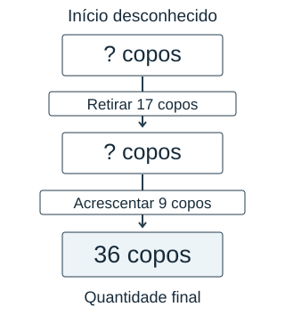

**Descrição do recurso visual:** Fluxo vertical: quantidade inicial desconhecida, retirada de 17 copos, quantidade intermediária desconhecida, acréscimo de nove copos e quantidade final de 36. As setas seguem a ordem real das mudanças.

- **A)** 28 copos.
- **B)** 44 copos.
- **C)** 62 copos.
- **D)** 10 copos.

**Gabarito: B.** Para voltar ao início, desfazemos primeiro a entrada: 36−9=27. Desfazemos a retirada somando 17: havia 44.

**Distratores:**

- A: Aplicar retirada e entrada de novo na mesma ordem.
- C: Somar as duas mudanças ao final.
- D: Subtrair as duas mudanças do final.

### MFC6-B1-I-ON-07 — Canal de envio mais rápido

**Dificuldade:** media. **Habilidade:** Comparar tempos totais que combinam parcela fixa e ritmo.

Uma turma precisa enviar uma pasta de 60 arquivos por um dos dois canais. Em cada canal, a preparação ocorre antes da transmissão. Considere velocidades constantes e os dados do esquema. Comparando o tempo total, algum canal termina antes do outro ou há empate?

**Descrição do recurso visual:** Pasta de 60 arquivos. Canal A: preparação de três minutos seguida de envio a seis arquivos por minuto. Canal B: preparação de sete minutos seguida de envio a dez arquivos por minuto. Os blocos indicam fases, não durações em escala; os totais não estão calculados.

- **A)** B termina em 6 minutos; A em 10.
- **B)** A termina em 3 minutos; B em 7.
- **C)** Empatam, ambos em 13 minutos.
- **D)** B termina em 13 minutos; A em 16.

**Gabarito: C.** A termina em 3+60÷6=13 minutos. B termina em 7+60÷10=13. Embora B transmita mais rápido, demora mais para preparar; há empate.

**Distratores:**

- A: Ignorar preparação.
- B: Ignorar transmissão.
- D: Somar preparo de A duas vezes.

### MFC6-B1-I-ON-08 — Desconto ou entrega grátis

**Dificuldade:** media. **Habilidade:** Comparar ofertas pela despesa total, não apenas pelo desconto.

Duas lojas vendem o mesmo equipamento pelo mesmo preço. A loja A dá desconto no produto e cobra entrega; a loja B vende pelo preço anunciado e oferece entrega grátis. Observe os dois esquemas de preço. Qual oferta gera o menor gasto total?

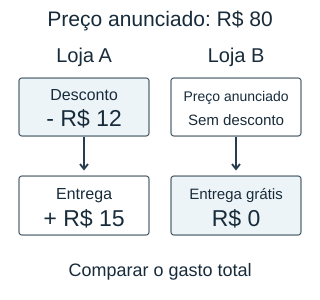

**Descrição do recurso visual:** Preço anunciado comum de R$ 80. Na loja A, desconto de R$ 12 e depois entrega de R$ 15. Na loja B, o preço anunciado é mantido e a entrega custa R$ 0. Os gastos finais não estão escritos.

- **A)** Loja A: R$ 68,00; B custa R$ 80,00.
- **B)** Loja A: R$ 65,00; B custa R$ 80,00.
- **C)** Loja B: R$ 80,00; A custa R$ 95,00.
- **D)** Loja B: R$ 80,00; A custa R$ 83,00.

**Gabarito: D.** A custa 80−12+15=83 reais; B custa 80. A entrega grátis de B economiza três reais em relação ao desconto de A.

**Distratores:**

- A: Omitir frete.
- B: Tratar frete como desconto.
- C: Omitir desconto de A.

### MFC6-B1-I-ON-09 — Pacotes inteiros pelo menor custo

**Dificuldade:** dificil. **Habilidade:** Combinar arredondamento de pacotes e comparação de custos.

Um painel precisa de 35 adesivos. A compra deve fornecer pelo menos essa quantidade e pode deixar adesivos sobrando. A loja vende somente pacotes inteiros, sem adesivos avulsos, e a compra deve usar um único tamanho de pacote. Observe os pacotes e seus preços. Qual tamanho de pacote dá o menor custo para atender à necessidade?

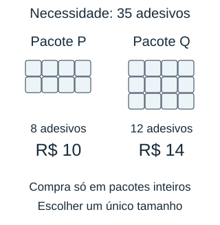

**Descrição do recurso visual:** Necessidade de 35 adesivos. Um pacote P tem oito adesivos, desenhados em duas linhas de quatro, e custa R$ 10. Um pacote Q tem doze adesivos, em três linhas de quatro, e custa R$ 14. Não são mostradas quantidades de pacotes a comprar.

- **A)** Q: R$ 42,00; P custaria R$ 50,00.
- **B)** P: R$ 40,00; Q custaria R$ 42,00.
- **C)** P: R$ 10,00; Q custaria R$ 14,00.
- **D)** Q: R$ 28,00; P custaria R$ 50,00.

**Gabarito: A.** P exige cinco pacotes, custo 50 reais. Q exige três pacotes, custo 42 reais, fornecendo 36 adesivos. O preço unitário do pacote sozinho não decide o custo da compra.

**Distratores:**

- B: Comprar quatro pacotes P fornece só 32.
- C: Comparar só um pacote.
- D: Dois pacotes Q não cobrem a necessidade.

### MFC6-B1-I-ON-10 — Caminho com uma ponte fechada

**Dificuldade:** dificil. **Habilidade:** Interpretar substituição de trecho e comparar estratégias de percurso.

Um mapa simplificado oferece dois caminhos entre a mesma origem e o mesmo destino. A ponte da rota A está fechada, e o desvio substitui o trecho da ponte: não se percorrem os dois. Observe o esquema e as distâncias em metros; o desenho não está em escala. Depois do fechamento, qual caminho é mais curto?

**Descrição do recurso visual:** As rotas ligam a mesma origem ao mesmo destino. Na rota A, os trechos externos têm 120 m e 150 m; a ponte de 80 m aparece tracejada e riscada. Um desvio de 170 m liga os mesmos extremos da ponte. A rota B tem trechos de 190 m e 210 m. O esquema não está em escala.

- **A)** A, com 350 m; B tem 400 m.
- **B)** B, com 400 m; A fica com 440 m.
- **C)** B, com 400 m; A fica com 520 m.
- **D)** A, com 270 m; B tem 400 m.

**Gabarito: B.** A passa a 120+170+150=440 m; B mede 190+210=400 m. B é 40 m mais curto. Somar o desvio sem retirar a ponte contaria dois caminhos para o mesmo trecho.

**Distratores:**

- A: Ignorar fechamento.
- C: Somar desvio sem retirar trecho substituído.
- D: Retirar ponte sem incluir desvio.

### MFC6-B1-I-ON-11 — Turnos com limites de uso

**Dificuldade:** dificil. **Habilidade:** Modelar repetição com intervalo somente entre atividades.

Um laboratório dispõe de um período total de 65 minutos. Cada experimento completo dura 12 minutos. Entre o fim de um experimento e o início do seguinte, são necessários 3 minutos de limpeza. Não há limpeza antes do primeiro nem depois do último experimento dentro desse período. Observe o esquema da sequência. Quantos experimentos completos cabem no período disponível?

**Descrição do recurso visual:** Sequência de experimentos de 12 minutos separados por limpezas de três minutos. Há três pontos indicando continuação, uma limpeza antes do último experimento e nenhuma depois dele. O período disponível é 65 minutos; o número total de experimentos ainda não é informado.

- **A)** 5.
- **B)** 3.
- **C)** 4.
- **D)** 6.

**Gabarito: C.** As limpezas acontecem somente entre experimentos: quatro experimentos precisam de três limpezas. Eles ocupam 4 × 12 + 3 × 3 = 48 + 9 = 57 minutos e cabem no período de 65 minutos. Cinco experimentos precisariam de quatro limpezas: 5 × 12 + 4 × 3 = 60 + 12 = 72 minutos, acima do disponível. Portanto, cabem no máximo quatro experimentos completos.

**Distratores:**

- A: Ignorar limpezas.
- B: Subestimar a capacidade e parar em três experimentos, sem conferir que um quarto ainda cabe.
- D: Ignorar as limpezas e arredondar 65 ÷ 12 para cima, embora seis experimentos nem caibam no tempo disponível.

### MFC6-B1-I-ON-12 — Reforma por faixas

**Dificuldade:** dificil. **Habilidade:** Escolher modelagem de duas áreas e usar distributividade.

Uma parede recebe duas faixas retangulares de tecido, lado a lado e sem sobreposição. As faixas têm a mesma altura. Observe as medidas no desenho. Qual expressão representa a área total coberta, sem contar os quadradinhos um por um?

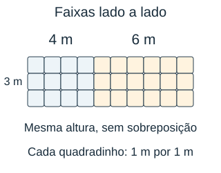

**Descrição do recurso visual:** Dois retângulos adjacentes têm altura comum de três metros e larguras de quatro e seis metros. A mesma escala é usada nos dois. Cada retângulo está dividido em quadradinhos de um metro por um metro; a área total não está escrita.

- **A)** 3 + 4 + 6, total de 13 m².
- **B)** (3 + 4) × 6, total de 42 m².
- **C)** 3 × 4 × 6, total de 72 m².
- **D)** 3 × (4 + 6), total de 30 m².

**Gabarito: D.** As áreas são 3×4 e 3×6; somam 30 m². Como têm a mesma altura, 3×(4+6) também representa o total. Não é 3+4+6, que mistura medidas de lados.

**Distratores:**

- A: Somar medidas lineares como áreas.
- B: Agrupar altura com uma largura indevidamente.
- C: Multiplicar as duas larguras em vez de somar áreas.

### MFC6-B1-I-ON-13 — Máquina que desfaz

**Dificuldade:** facil. **Habilidade:** Escolher a ordem correta das operações inversas.

Um jogo transforma um número multiplicando-o por 4 e depois acrescentando 7. O resultado foi 39. Qual ação recupera o número inicial? Escolha a alternativa que responde à situação.

- **A)** Subtrair 7 e dividir por 4: 8.
- **B)** Somar 7 e dividir por 4: 11,5.
- **C)** Subtrair 7 e multiplicar por 4: 128.
- **D)** Subtrair 4 e dividir por 7: 5.

**Gabarito: A.** Primeiro retiramos 7 e depois dividimos por 4: (39−7)÷4=8. A ordem inversa desfaz corretamente as etapas.

**Distratores:**

- B: Somar em vez de desfazer a adição.
- C: Não desfazer a multiplicação.
- D: Trocar os papéis dos parâmetros.

### MFC6-B1-I-ON-14 — Excluindo cópias e preservando originais

**Dificuldade:** facil. **Habilidade:** Distinguir originais, cópias e total em grupos.

Uma pasta tem 8 arquivos originais. Cada um foi copiado duas vezes, além do original. Apagar apenas todas as cópias deixa quantos arquivos? Escolha a alternativa que responde à situação.

- **A)** 16.
- **B)** 8.
- **C)** 24.
- **D)** 0.

**Gabarito: B.** Cada original gera duas cópias, mas continua existindo. Apagar as 16 cópias deixa os oito originais. Não se apagam todos os 24 arquivos.

**Distratores:**

- A: Responder a quantidade apagada.
- C: Ignorar a exclusão.
- D: Apagar os originais junto das cópias.

### MFC6-B1-I-ON-15 — Desconto que cabe no orçamento

**Dificuldade:** media. **Habilidade:** Interpretar déficit como desconto mínimo.

Uma oficina tem 120 reais para dois serviços: um custa 75 e o outro 60. Quanto desconto total mínimo é necessário para contratar ambos? Escolha a alternativa que responde à situação.

- **A)** R$ 45,00.
- **B)** R$ 60,00.
- **C)** R$ 15,00.
- **D)** R$ 135,00.

**Gabarito: C.** Os serviços somam 135 reais. Para caber em 120, o desconto deve ser pelo menos 15 reais. Não é necessário reduzir cada serviço ao mesmo preço.

**Distratores:**

- A: Considerar somente o primeiro serviço.
- B: Confundir desconto com preço de um serviço.
- D: Confundir custo total com excesso do orçamento.

### MFC6-B1-I-ON-16 — Parede de pixels com buraco

**Dificuldade:** media. **Habilidade:** Modelar área com recorte usando produtos e diferença.

Um desenho digital usa um retângulo de 9 por 7 pixels. Um recorte interno de 3 por 2 pixels deve ficar transparente. Quantos pixels serão coloridos? Escolha a alternativa que responde à situação.

- **A)** 63.
- **B)** 69.
- **C)** 58.
- **D)** 57.

**Gabarito: D.** O retângulo tem 63 pixels; o recorte remove seis. Serão coloridos 57. Somar os recortes ou subtrair apenas os lados não representa a área.

**Distratores:**

- A: Ignorar recorte.
- B: Somar área do recorte.
- C: Subtrair 3+2, não 3×2.

### MFC6-B1-I-ON-17 — Três dias de teste

**Dificuldade:** media. **Habilidade:** Comparar demanda restante com capacidade disponível.

Uma equipe precisa testar 52 sensores. No primeiro dia testa 18 e no segundo 16. No terceiro há tempo para no máximo 20. O prazo pode ser cumprido? Escolha a alternativa que responde à situação.

- **A)** Sim; faltam 18 e há capacidade para 20.
- **B)** Não; faltam 34, acima de 20.
- **C)** Sim; faltam 16.
- **D)** Não; faltam 36.

**Gabarito: A.** Faltam 52−18−16=18 sensores. Como cabem 20 no último dia, o prazo pode ser cumprido, sobrando capacidade para dois.

**Distratores:**

- B: Responder o já testado como restante.
- C: Confundir os 16 sensores testados no segundo dia com a quantidade que ainda falta testar.
- D: Retirar só o segundo dia.

### MFC6-B1-I-ON-18 — Reaproveitar peças de encaixe

**Dificuldade:** media. **Habilidade:** Eliminar duplicações em uma cadeia de agrupamentos.

Uma estrutura usa cinco segmentos em linha. Cada segmento tem quatro peças, mas segmentos vizinhos compartilham uma peça na junção. Quantas peças diferentes são usadas? Escolha a alternativa que responde à situação.

- **A)** 20.
- **B)** 16.
- **C)** 15.
- **D)** 12.

**Gabarito: B.** São 20 contagens de peças, mas há quatro junções com uma peça contada duas vezes. O total distinto é 16. Uma cadeia de cinco segmentos tem quatro junções.

**Distratores:**

- A: Ignorar peças compartilhadas.
- C: Subtrair cinco junções em vez de quatro.
- D: Retirar duas peças por junção.

### MFC6-B1-I-ON-19 — Comparação sem calcular os produtos inteiros

**Dificuldade:** dificil. **Habilidade:** Comparar produtos e argumentar sobre compensação entre fatores.

Uma escola precisa escolher entre a oferta A, com 49 caixas de 20 folhas cada, e a oferta B, com 50 caixas de 19 folhas cada. Qual oferta tem mais folhas e por quantas? Escolha a alternativa que responde à situação.

- **A)** B, com 30 a mais.
- **B)** Empate.
- **C)** A, com 30 folhas a mais.
- **D)** A, com 1 a mais.

**Gabarito: C.** Podemos comparar por compensação, usando a mesma referência: 50 caixas com 20 folhas cada. A oferta A tem uma caixa de 20 folhas a menos que essa referência, portanto retira 20 folhas. A oferta B tem uma folha a menos em cada uma das 50 caixas, portanto retira 50 folhas. Como a oferta A retira 30 folhas a menos (50 − 20 = 30), ela fornece 30 folhas a mais que B, sem precisar calcular os dois produtos completos. Como conferência, A fornece 49 × 20 = 980 folhas e B fornece 50 × 19 = 950 folhas; a diferença também é 30.

**Distratores:**

- A: Escolher só a quantidade de caixas.
- B: Supor que alterações opostas nos fatores se compensam sempre.
- D: Comparar apenas a diferença de um fator.

### MFC6-B1-I-ON-20 — Planejamento com reserva

**Dificuldade:** dificil. **Habilidade:** Separar capacidade total, reserva obrigatória e demanda.

Um grupo leva 6 baterias, cada uma com autonomia de 35 minutos. Quarenta minutos devem ser reservados para emergência. Uma atividade exige 170 minutos. Qual é a situação? Escolha a alternativa que responde à situação.

- **A)** Sobram 40 minutos além da reserva.
- **B)** Faltam 40 minutos.
- **C)** Sobram 210 minutos.
- **D)** Atende exatamente, com margem de 0 minuto fora da reserva.

**Gabarito: D.** A autonomia total é 210 minutos. Retirando a reserva, restam 170 para a atividade: atende exatamente, sem margem fora da reserva.

**Distratores:**

- A: Usar a reserva como tempo disponível.
- B: Retirar a reserva duas vezes.
- C: Confundir capacidade total com margem.

## Múltiplos e divisores

### MFC6-B1-I-MD-01 — Última casa do tabuleiro

**Dificuldade:** facil. **Habilidade:** Interpretar resto como impossibilidade de atingir um ponto em uma sequência.

Um jogo percorre casas em saltos sempre iguais, começando na casa zero. Observe a reta com os saltos e a casa final indicada. A peça pode parar exatamente na casa final sem ultrapassá-la?

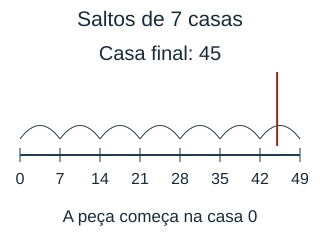

**Descrição do recurso visual:** Reta de casas de zero a 49, com marcas 0, 7, 14, 21, 28, 35, 42 e 49 e arcos de salto entre marcas consecutivas. A casa final 45 tem uma linha de alvo entre as marcas 42 e 49. A peça começa no zero; não há resposta escrita.

- **A)** Não; fica entre 42 e 49 e o resto é 3.
- **B)** Sim; o resto é 0.
- **C)** Não; o resto é 7.
- **D)** Não; o resto é 6.

**Gabarito: A.** Os saltos chegam a 42 e depois 49. Como 45 deixa resto 3 na divisão por 7, não será atingida. A distância curta não torna a casa múltipla do salto.

**Distratores:**

- B: Supor que qualquer casa é alcançável.
- C: Usar o divisor como resto, que deve ser menor que sete.
- D: Confundir quociente inteiro com resto.

### MFC6-B1-I-MD-02 — Caixas e recombinação dos agrupamentos

**Dificuldade:** facil. **Habilidade:** Recombinar restos de dois agrupamentos para verificar divisibilidade do total.

Duas caixas foram embaladas separadamente em grupos de seis objetos. As sobras podem ser reunidas sem alterar os grupos completos. Observe o esquema das caixas e dos agrupamentos. Ao reunir as duas caixas, será possível embalar tudo em grupos de seis?

**Descrição do recurso visual:** Caixa A com 16 objetos: dois grupos completos de seis e quatro objetos no último agrupamento. Caixa B com 14 objetos: dois grupos completos de seis e dois no último agrupamento. Cada objeto aparece uma vez; a recombinação e o total final não estão desenhados.

- **A)** Não; só os quatro grupos já completos podem ser usados.
- **B)** Sim, formam cinco grupos completos.
- **C)** Sim, formam seis grupos completos.
- **D)** Não; só há dois grupos completos no total.

**Gabarito: B.** A primeira caixa deixa quatro objetos e a segunda deixa dois. As sobras juntas formam outro grupo de seis. O total é 30, suficiente para cinco grupos sem sobra; não é necessário que cada caixa individual seja múltipla de seis.

**Distratores:**

- A: Ignorar a recombinação das duas sobras.
- C: Confundir tamanho do grupo com número de grupos.
- D: Considerar somente uma caixa.

### MFC6-B1-I-MD-03 — Mesmo total, pacotes diferentes

**Dificuldade:** media. **Habilidade:** Combinar agrupamento exato e capacidade máxima de transporte.

Uma editora aceita a devolução de todos os objetos de cada professor somente em pacotes completos de seis objetos, sem objetos avulsos nem sobras. Nesta viagem, a transportadora pode levar no máximo sete pacotes de cada professor. Observe as quantidades e o esquema das regras. Qual professor consegue devolver todos os seus objetos sem ultrapassar esse limite?

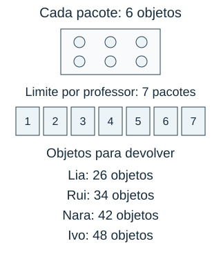

**Descrição do recurso visual:** Um pacote tem seis objetos em duas linhas de três. Sete espaços numerados representam o limite de pacotes por professor. Abaixo, Lia tem 26 objetos, Rui 34, Nara 42 e Ivo 48 para devolver. Não estão calculados os pacotes de cada professor.

- **A)** Lia.
- **B)** Rui.
- **C)** Nara.
- **D)** Ivo.

**Gabarito: C.** Nara devolve 42 objetos, formando sete pacotes, exatamente o limite. Ivo formaria oito pacotes e ultrapassaria o limite. Lia e Rui deixam restos, portanto seus pacotes não ficam completos.

**Distratores:**

- A: Aceitar qualquer número par.
- B: Truncar o quociente de 34 ÷ 6 e ignorar quatro objetos.
- D: Verificar divisibilidade de 48 por seis, mas ignorar o limite de sete pacotes.

### MFC6-B1-I-MD-04 — Quatro rodas por carrinho

**Dificuldade:** facil. **Habilidade:** Aplicar divisibilidade à quantidade disponível depois de uma reserva obrigatória.

Uma oficina vai montar carrinhos de quatro rodas. Antes da montagem, deve separar duas rodas como reserva de reposição. Observe o esquema dos lotes, da reserva e da montagem. Qual lote permite usar todas as rodas restantes em carrinhos completos, sem sobra?

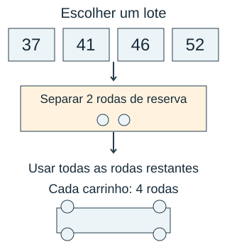

**Descrição do recurso visual:** Quatro opções de lote: 37, 41, 46 e 52 rodas. O fluxo separa duas rodas de reserva e encaminha todas as restantes para carrinhos. O modelo de carrinho mostra quatro rodas. As quantidades após a reserva não estão calculadas.

- **A)** 37 rodas.
- **B)** 41 rodas.
- **C)** 52 rodas.
- **D)** 46 rodas.

**Gabarito: D.** Após reservar duas rodas, os lotes deixam 35,39,44 e 50. Somente 44 é divisível por quatro: onze carrinhos. O lote de 52, embora múltiplo de quatro antes da reserva, deixa 50 e não atende.

**Distratores:**

- A: Ignorar que, após reserva, 35 não é múltiplo de quatro.
- B: Usar o total ou sua proximidade a um múltiplo, ignorando sobra.
- C: Testar divisibilidade antes de retirar a reserva.

### MFC6-B1-I-MD-05 — Cartões com mesma composição

**Dificuldade:** media. **Habilidade:** Reconhecer máximo divisor comum em repartição com composição idêntica.

Um laboratório tem dois tipos de amostra. Todos os kits devem ter a mesma quantidade de cada tipo, usando tudo e fazendo o maior número possível de kits. Observe as amostras e o modelo de distribuição no esquema. Quantos kits podem ser feitos?

**Descrição do recurso visual:** Dois conjuntos de unidades: 24 amostras A, em quatro linhas de seis, e 36 amostras B, em seis linhas de seis. Uma seta conduz a um modelo de kit com quantidades desconhecidas de A e B, iguais em todos os kits. Nenhuma composição ou quantidade final de kits está indicada.

- **A)** 12 kits.
- **B)** 6 kits.
- **C)** 24 kits.
- **D)** 72 kits.

**Gabarito: A.** O número de kits deve dividir 24 e 36. O maior divisor comum é 12; cada kit recebe duas amostras A e três B. MMC trata ciclos, não esse repartimento.

**Distratores:**

- B: Escolher divisor comum que não é o maior.
- C: Verificar apenas um tipo.
- D: Usar MMC em vez de MDC.

### MFC6-B1-I-MD-06 — Uma planta entre estacas

**Dificuldade:** media. **Habilidade:** Distinguir intervalos de pontos em uma sequência de múltiplos.

Uma borda de jardim tem estacas igualmente espaçadas. As plantas serão colocadas junto às estacas correspondentes, começando na primeira estaca e avançando dois espaços entre estacas a cada plantio. Observe o esquema. Quantas plantas ficam da primeira até a última estaca, incluindo uma planta em cada extremo?

**Descrição do recurso visual:** Dezenove estacas marcam dezoito espaços iguais em uma linha. Os plantios iniciais aparecem junto às estacas 0 e 2, com arco de dois espaços; o plantio no extremo final aparece junto à estaca 18. Os plantios intermediários ficam a determinar seguindo o mesmo avanço. Os dois extremos são incluídos.

- **A)** 9 plantas.
- **B)** 10 plantas.
- **C)** 18 plantas.
- **D)** 19 plantas.

**Gabarito: B.** Dezoito espaços correspondem a nove intervalos de plantio. Contando a planta inicial, são dez plantas nas posições 0,2,4,...,18.

**Distratores:**

- A: Omitir o ponto inicial.
- C: Plantar em todo espaço.
- D: Plantar em todas as estacas, não a cada dois espaços.

### MFC6-B1-I-MD-07 — Sinal que começou depois

**Dificuldade:** media. **Habilidade:** Interpretar ciclos com instantes iniciais diferentes.

O sinal luminoso A aparece inicialmente no minuto zero e depois volta a aparecer a cada seis minutos. O sinal B aparece inicialmente no minuto três e depois volta a aparecer a cada nove minutos. Observe as linhas do tempo. Em qual minuto eles aparecem juntos pela primeira vez?

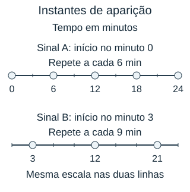

**Descrição do recurso visual:** Duas linhas do tempo com a mesma escala de zero a 24 minutos. A aparece nos minutos 0, 6, 12, 18 e 24; B aparece nos minutos 3, 12 e 21. São indicados os inícios zero e três e os intervalos seis e nove. Nenhum encontro está nomeado ou destacado.

- **A)** 18 minutos.
- **B)** 9 minutos.
- **C)** 12 minutos.
- **D)** 6 minutos.

**Gabarito: C.** A aparece nos minutos 0, 6, 12, 18, 24, ...; B aparece nos minutos 3, 12, 21, 30, ... . O primeiro instante comum é o minuto 12. Calcular MMC(6, 9) = 18 sem considerar os instantes iniciais ignoraria que B começou três minutos depois de A.

**Distratores:**

- A: Usar MMC sem considerar o deslocamento inicial.
- B: Somar início de B a um intervalo de A.
- D: Verificar apenas o primeiro sinal.

### MFC6-B1-I-MD-08 — Cortar sem sobras

**Dificuldade:** media. **Habilidade:** Maximizar uma medida comum em cortes exatos.

Duas fitas serão cortadas em pedaços de mesmo comprimento inteiro, usando toda a fita. A oficina quer os pedaços mais compridos possíveis. Observe as fitas e suas medidas no esquema. Qual comprimento deve ser escolhido?

**Descrição do recurso visual:** Fita A de 54 cm e fita B de 72 cm, alinhadas à esquerda e desenhadas na mesma escala, quatro pixels por centímetro. Um modelo de pedaço tem comprimento desconhecido, sem escala de corte definida. Não há divisões ou comprimento de resposta indicado.

- **A)** 9 cm.
- **B)** 27 cm.
- **C)** 72 cm.
- **D)** 18 cm.

**Gabarito: D.** O comprimento deve dividir 54 e 72. O MDC é 18: saem três pedaços da primeira e quatro da segunda. O comprimento 27 não divide 72.

**Distratores:**

- A: Escolher medida comum sem maximizar.
- B: Considerar só a primeira fita.
- C: Escolher a maior fita como tamanho comum.

### MFC6-B1-I-MD-09 — Cartaz retangular com linhas limitadas

**Dificuldade:** dificil. **Habilidade:** Relacionar primalidade à impossibilidade de arranjo retangular não trivial.

Um painel será montado com todas as peças, em um retângulo com pelo menos duas linhas e duas colunas. Observe as peças disponíveis no esquema; elas podem ser reorganizadas para montar o painel. Qual conclusão é correta para a quantidade dada?

**Descrição do recurso visual:** Trinta e sete peças individuais disponíveis, desenhadas em cinco linhas de sete e uma linha de duas apenas para contagem do estoque. Elas devem ser reorganizadas em um retângulo com pelo menos duas linhas e duas colunas, usando todas sem sobra. O estoque não representa um painel pronto.

- **A)** Não é possível; não há divisor que produza duas dimensões maiores que 1.
- **B)** É possível usar 3 linhas de 12 peças.
- **C)** É possível usar 4 linhas de 9 peças.
- **D)** É possível usar 2 linhas, pois todo ímpar é divisível por 2.

**Gabarito: A.** Para usar todas as 37 peças, o número de linhas deve dividir 37 sem sobra. Se houvesse pelo menos sete linhas e sete colunas, seriam necessárias pelo menos 7 × 7 = 49 peças. Assim, em qualquer retângulo permitido, uma das dimensões teria de ser 2, 3, 4, 5 ou 6. Ao agrupar 37 peças nessas quantidades, há sobra: 37 = 2 × 18 + 1; 37 = 3 × 12 + 1; 37 = 4 × 9 + 1; 37 = 5 × 7 + 2; 37 = 6 × 6 + 1. Portanto, nenhum desses agrupamentos usa todas as peças. Só são possíveis 1 × 37 e 37 × 1, que não atendem à exigência de pelo menos duas linhas e duas colunas.

**Distratores:**

- B: Aceitar uma peça sobrando.
- C: Aceitar uma peça sobrando.
- D: Confundir ímpar e par.

### MFC6-B1-I-MD-10 — Pacotes entre dois limites

**Dificuldade:** dificil. **Habilidade:** Combinar múltiplos comuns com uma restrição de tamanho mínimo.

Uma loja só prepara remessas cujo total possa ser organizado tanto em grupos de oito como em grupos de doze, sem sobra. Observe os modelos de agrupamento e o limite na reta. Qual é o menor total permitido acima do limite inferior?

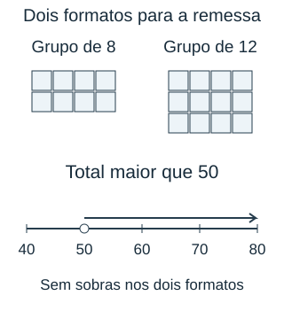

**Descrição do recurso visual:** Um grupo de oito unidades e um grupo de doze unidades, ambos desenhados por objetos. A reta mostra 40, 50, 60, 70 e 80; o ponto 50 é aberto e uma seta aponta para totais maiores. Os múltiplos comuns não estão assinalados.

- **A)** 48 objetos.
- **B)** 72 objetos.
- **C)** 60 objetos.
- **D)** 56 objetos.

**Gabarito: B.** Os totais possíveis são múltiplos do MMC(8,12)=24. Depois de 50, o primeiro é 72; 48 é menor que o limite.

**Distratores:**

- A: Ignorar limite inferior.
- C: Verificar apenas grupos de doze.
- D: Verificar apenas grupos de oito.

### MFC6-B1-I-MD-11 — Páginas marcadas por dois monitores

**Dificuldade:** dificil. **Habilidade:** Contar união de múltiplos sem repetir interseções.

No intervalo de páginas indicado, um monitor marca múltiplos de quatro e outro marca múltiplos de seis. Páginas marcadas pelos dois contam uma vez. Observe o quadro de páginas e a legenda das marcações. Quantas páginas são marcadas por pelo menos um monitor?

**Descrição do recurso visual:** Quadro com páginas de 1 a 24. Triângulos do monitor A marcam 4, 8, 12, 16, 20 e 24. Quadrados do monitor B marcam 6, 12, 18 e 24. As páginas 12 e 24 têm as duas formas. A legenda diferencia as marcas por forma e texto, sem apresentar o total de páginas marcadas.

- **A)** 10 páginas.
- **B)** 2 páginas.
- **C)** 8 páginas.
- **D)** 6 páginas.

**Gabarito: C.** Há seis múltiplos de quatro e quatro de seis. As páginas 12 e 24 foram contadas duas vezes; total 6+4−2=8.

**Distratores:**

- A: Somar sem retirar interseção.
- B: Contar só os múltiplos comuns.
- D: Considerar apenas um monitor.

### MFC6-B1-I-MD-12 — Calendário que não recomeça na segunda

**Dificuldade:** dificil. **Habilidade:** Cruzar ciclo de atividade e ciclo semanal sem reinicialização.

Uma inspeção ocorre a cada quatro dias a partir de uma segunda-feira. A semana tem sete dias, e o ciclo continua sem reiniciar. Observe o calendário, em que o dia zero é a segunda-feira da primeira inspeção. Depois de quantos dias a inspeção volta a cair numa segunda-feira?

**Descrição do recurso visual:** Calendário de dias decorridos, começando no dia zero em uma segunda-feira. As colunas são segunda a domingo; os dias seguem de zero a 28. Círculos indicam inspeções nos dias 0, 4, 8, 12, 16, 20, 24 e 28. O ciclo continua entre semanas; nenhuma data de resposta está destacada de modo diferente.

- **A)** 7 dias.
- **B)** 11 dias.
- **C)** 14 dias.
- **D)** 28 dias.

**Gabarito: D.** O tempo deve ser múltiplo de quatro e de sete. O menor positivo é 28; ocorre após sete intervalos de inspeção e quatro semanas.

**Distratores:**

- A: Verificar só a semana.
- B: Somar os ciclos.
- C: Contar duas semanas sem exigir múltiplo de quatro.

### MFC6-B1-I-MD-13 — É preciso contar cada peça?

**Dificuldade:** facil. **Habilidade:** Justificar divisibilidade a partir dos fatores de um produto.

Um depósito recebeu 15 pacotes com 8 sensores em cada um. Sem abrir pacotes, é possível garantir que o total seja divisível por 4? Escolha a alternativa que responde à situação.

- **A)** Sim, porque cada pacote já contém dois grupos completos de quatro.
- **B)** Não, porque 15 é ímpar.
- **C)** Não, porque o total termina em zero e não em quatro.
- **D)** Não, porque seria preciso ter quatro pacotes.

**Gabarito: A.** Sim. Cada pacote de oito pode ser dividido em dois grupos de quatro; quinze pacotes também formam grupos completos. O total 120 é divisível por quatro.

**Distratores:**

- B: Analisar apenas o número de pacotes.
- C: Confundir critério de divisibilidade com último algarismo igual ao divisor.
- D: Confundir número de grupos com tamanho de grupo.

### MFC6-B1-I-MD-14 — Dois números consecutivos

**Dificuldade:** facil. **Habilidade:** Argumentar sobre paridade de um produto de consecutivos.

Uma atividade numera duas peças com naturais consecutivos. O produto dessas duas etiquetas pode ser ímpar? Escolha a alternativa que responde à situação.

- **A)** Sim; se o primeiro for ímpar, os dois serão ímpares.
- **B)** Não; sempre há um fator par.
- **C)** Sim; se o segundo for maior que dez.
- **D)** Sim; todo produto de números diferentes é ímpar.

**Gabarito: B.** Não. Entre dois naturais consecutivos, um é par; seu produto tem o fator 2. Os exemplos ilustram, mas a conclusão usa a alternância de paridade, não apenas dois testes.

**Distratores:**

- A: Ignorar alternância entre consecutivos.
- C: Usar tamanho do número em vez de paridade.
- D: Generalização sem relação com divisibilidade.

### MFC6-B1-I-MD-15 — Organizar duas prateleiras sem conhecer o total

**Dificuldade:** media. **Habilidade:** Usar restos para justificar paridade de uma soma.

Cada uma de duas caixas tem uma quantidade ímpar de peças. Ao reunir as caixas, é garantido que o total seja par? Escolha a alternativa que responde à situação.

- **A)** Não; juntar dois ímpares sempre dá ímpar.
- **B)** Não; só se as caixas tiverem a mesma quantidade.
- **C)** Sim; as sobras de uma peça se juntam e completam outro par.
- **D)** Não; só se as quantidades forem múltiplas de dez.

**Gabarito: C.** Sim. Cada caixa deixa uma peça ao formar pares; as duas peças restantes formam outro par. Ímpar mais ímpar é par.

**Distratores:**

- A: Transportar a paridade de cada parcela para a soma.
- B: Exigir igualdade onde basta paridade.
- D: Usar critério de dez para decidir paridade.

### MFC6-B1-I-MD-16 — Separar milhares ajuda a decidir

**Dificuldade:** media. **Habilidade:** Verificar divisibilidade por decomposição em parcelas divisíveis e avaliar um argumento incompleto.

Uma fábrica recebeu 8.136 peças para caixas de oito. Uma pessoa afirmou que haveria sobra porque 36 não é divisível por oito. Outra separou mentalmente 8.000 peças e 136 peças. Qual conclusão e quantidade de caixas completas estão corretas?

- **A)** Há sobra; só podem ser feitas 1.000 caixas.
- **B)** Não há sobra; podem ser feitas 1.136 caixas.
- **C)** Há sobra; podem ser feitas 17 caixas.
- **D)** Não há sobra; podem ser feitas 1.017 caixas.

**Gabarito: D.** 8.000 é múltiplo de oito e forma 1.000 caixas. As 136 peças também são: 136÷8=17. O total é 1.017 caixas sem sobra. Analisar somente 36 não preserva a divisibilidade por oito; retirar milhares que são múltiplos de oito preserva.

**Distratores:**

- A: Ignorar 136 peças ou analisar apenas os dois últimos algarismos.
- B: Somar 136 peças ao número de caixas, sem dividir essa parcela.
- C: Considerar apenas as 136 peças finais.

### MFC6-B1-I-MD-17 — A próxima posição da cor

**Dificuldade:** media. **Habilidade:** Interpretar resto em sequência cíclica com índice inicial um.

Uma faixa repete a sequência azul, verde, amarelo, vermelho, nessa ordem; a primeira posição é azul. Qual é a cor na posição 26? Escolha a alternativa que responde à situação.

- **A)** Verde.
- **B)** Azul.
- **C)** Amarelo.
- **D)** Vermelho.

**Gabarito: A.** Cada bloco de quatro posições repete a sequência. As posições 25 e 26 iniciam o sétimo bloco: azul e verde. O deslocamento usa posição menos um.

**Distratores:**

- B: Usar quociente sem localizar a posição dentro do ciclo.
- C: Usar resto como índice começando do zero sem ajustar a posição.
- D: Considerar apenas blocos completos.

### MFC6-B1-I-MD-18 — Peças para um quadrado

**Dificuldade:** media. **Habilidade:** Comparar o total com produtos quadrados vizinhos.

Uma oficina tem 48 peças. Depois de acrescentar a quantidade mínima necessária, todas as peças serão reorganizadas para formar um quadrado com o mesmo número inteiro de linhas e de colunas, sem sobras. Quantas peças precisa acrescentar? Escolha a alternativa que responde à situação.

- **A)** 12 peças.
- **B)** 1 peça.
- **C)** 16 peças.
- **D)** 0 peça.

**Gabarito: B.** O quadrado imediatamente maior tem 7×7=49 peças; basta acrescentar uma. Seis por seis usa só 36, deixando sobras, e não atende ao uso de todas.

**Distratores:**

- A: Usar a diferença para o quadrado anterior.
- C: Pular o quadrado de 49 e ir para 64.
- D: Confundir retângulo com quadrado.

### MFC6-B1-I-MD-19 — Encontro impossível dos alertas

**Dificuldade:** dificil. **Habilidade:** Usar classes de resto para provar impossibilidade de coincidência.

Um alerta aparece nos minutos 0,4,8,12,...; outro nos minutos 1,5,9,13,... . O monitor pergunta se haverá um encontro se esperar bastante. Qual conclusão é correta? Escolha a alternativa que responde à situação.

- **A)** Sim; basta esperar quatro minutos.
- **B)** Sim; todo par de ciclos acaba coincidindo.
- **C)** Não; os instantes mantêm restos diferentes na divisão por quatro.
- **D)** Sim; no minuto cinco, os dois já apareceram antes.

**Gabarito: C.** Não há encontro: o primeiro alerta deixa resto zero ao dividir seu minuto por quatro; o segundo deixa resto um. Esperar mais repete esses restos, sem uni-los.

**Distratores:**

- A: Usar período comum sem considerar inícios.
- B: Generalizar indevidamente o MMC para ciclos deslocados.
- D: Confundir terem ocorrido com ocorrerem simultaneamente.

### MFC6-B1-I-MD-20 — Bandejas de tamanho primo

**Dificuldade:** dificil. **Habilidade:** Identificar todos os divisores primos de um produto e aplicar restrição material de tamanho.

Uma oficina recebeu uma remessa cujo total de peças está descrito por 2 × 3 × 3 × 7. Ela só pode comprar bandejas com uma quantidade prima de lugares e quer distribuir todas as peças em bandejas iguais, sem sobra. Qual conjunto lista todos os tamanhos de bandeja possíveis?

- **A)** 6 e 7.
- **B)** 2, 3, 7 e 9.
- **C)** 2 e 7.
- **D)** 2, 3 e 7.

**Gabarito: D.** Os fatores primos distintos do total são 2, 3 e 7. Cada um divide o produto 2 × 3 × 3 × 7, permitindo bandejas completas. O fator 3 repetido não representa um novo tamanho. Seis e nove dividem o total, mas são compostos: 6 = 2 × 3 e 9 = 3 × 3. Portanto, não atendem à regra de tamanho primo.

**Distratores:**

- A: Agrupar os fatores 2 e 3 em 6 e tratá-lo como tamanho primo, embora 6 seja composto, omitindo também os tamanhos primos 2 e 3.
- B: Aceitar divisor composto, apesar da exigência de tamanho primo.
- C: Omitir o primo que aparece duas vezes na fatoração.

## Frações

### MFC6-B1-I-FR-01 — Duas placas de tamanhos diferentes

**Dificuldade:** facil. **Habilidade:** Comparar quantidades fracionárias com inteiros de referência diferentes.

Duas placas retangulares serão pintadas. Cada fração se refere à área total da respectiva placa. Observe as placas e as áreas informadas. Os desenhos usam a mesma escala de área, mas as placas têm formatos retangulares diferentes. Qual placa tem maior área pintada?

![Diagrama: Duas placas retangulares na mesma escala de área, com formatos diferentes. A tem área total de 12 cm² e formato horizontal de 240 por 60 unidades gráficas: duas partes iguais de 120 por 60, com uma pintada. B tem área total de 8 cm² e formato vertical de 80 por 120 unidades gráficas: quatro partes iguais de 80 por 30, com três pintadas. As frações 1/2 e 3/4 estão identificadas. As regiões pintadas têm formatos distintos, não estão sobrepostas nem alinhadas para comparação direta e suas áreas não estão calculadas.](recursos/MFC6-B1-I-FR-01.svg)

**Descrição do recurso visual:** Duas placas retangulares na mesma escala de área, com formatos diferentes. A tem área total de 12 cm² e formato horizontal de 240 por 60 unidades gráficas: duas partes iguais de 120 por 60, com uma pintada. B tem área total de 8 cm² e formato vertical de 80 por 120 unidades gráficas: quatro partes iguais de 80 por 30, com três pintadas. As frações 1/2 e 3/4 estão identificadas. As regiões pintadas têm formatos distintos, não estão sobrepostas nem alinhadas para comparação direta e suas áreas não estão calculadas.

- **A)** As áreas pintadas são iguais: 6 cm² em cada.
- **B)** B: 3/4 é sempre uma quantidade maior que 1/2.
- **C)** A: tem 12 cm² pintados e B tem 8 cm².
- **D)** A: 6 cm²; B: 2 cm².

**Gabarito: A.** A tem 12×1/2=6 cm² pintados; B tem 8×3/4=6 cm². As áreas pintadas são iguais, embora 3/4 seja uma fração maior: os inteiros são diferentes.

**Distratores:**

- B: Comparar frações sem considerar o tamanho do inteiro.
- C: Confundir área total com área pintada.
- D: Calcular 1/4, não 3/4, da placa B.

### MFC6-B1-I-FR-02 — Metade de uma metade

**Dificuldade:** facil. **Habilidade:** Identificar fração ao mudar de um subinteiro para o inteiro original.

Uma folha foi dobrada ao meio; depois, apenas uma das metades foi dividida em duas partes iguais para fazer etiquetas. Observe o esquema da folha. Uma dessas etiquetas corresponde a qual fração da folha original?

**Descrição do recurso visual:** Folha retangular de 240 por 100 unidades gráficas. A metade esquerda é subdividida em duas regiões de 120 por 50; a região superior esquerda é a etiqueta destacada. A metade direita tem 120 por 100 e permanece inteira. Há duas etiquetas de mesma área e uma região maior; nenhuma fração de resposta está escrita.

- **A)** 1/2.
- **B)** 1/4.
- **C)** 2/3.
- **D)** 1/3.

**Gabarito: B.** A etiqueta é metade de uma metade: 1/2 × 1/2 = 1/4 da folha. O inteiro de referência continua sendo a folha inicial, não a metade. As três regiões finais não possuem todas a mesma área: a metade não subdividida ocupa 1/2 da folha, enquanto cada uma das duas etiquetas ocupa 1/4. Por isso, contar três regiões e concluir que cada uma representa 1/3 seria incorreto.

**Distratores:**

- A: Usar a metade recortada como inteiro.
- C: Contar peças finais sem comparar seus tamanhos.
- D: Supor que as três peças finais têm áreas iguais.

### MFC6-B1-I-FR-03 — Dois lotes com o mesmo inteiro

**Dificuldade:** facil. **Habilidade:** Somar frações de um mesmo inteiro e interpretar margem de disponibilidade.

Um serviço de encadernação usa partes de uma bobina. As reservas são medidas em frações da mesma bobina. Observe as barras, que representam separadamente cada reserva em relação à bobina inteira. As duas reservas cabem na bobina sem faltar material?

**Descrição do recurso visual:** Duas barras de igual comprimento representam a mesma bobina inteira de referência. A reserva A destaca duas de cinco partes iguais; a reserva B destaca três de dez partes iguais. Cada barra tem extremos zero e uma bobina. Não há barra da soma nem do restante.

- **A)** Sim; restam 2/3.
- **B)** Não; faltam 1/10.
- **C)** Sim; restam 3/10.
- **D)** Sim; restam 7/10.

**Gabarito: C.** 2/5=4/10; juntas as reservas usam 7/10. Cabem, e restam 3/10. Somar denominadores não representa a soma dessas quantidades.

**Distratores:**

- A: Somar como 5/15 e calcular o complemento.
- B: Comparar apenas os numeradores e supor excesso.
- D: Responder a parte reservada, não a restante.

### MFC6-B1-I-FR-04 — O corte de oitavos mais próximo do pedido

**Dificuldade:** media. **Habilidade:** Comparar aproximações fracionárias sob restrição de marcas discretas.

Uma faixa só pode ser cortada nas marcas que a dividem em oito partes iguais. Uma encomenda pede três décimos da faixa, mas permite usar a marca mais próxima. Observe a reta fracionária com as marcas de corte e a posição do pedido. Qual fração deve ser cortada para minimizar a diferença?

**Descrição do recurso visual:** Reta fracionária de zero a um, com nove marcas igualmente espaçadas: zero, 1/8, 2/8, 3/8, 4/8, 5/8, 6/8, 7/8 e um. Uma seta marca 3/10 na posição exata, entre 2/8 e 3/8. Nenhuma marca é destacada como escolha correta e as diferenças não estão calculadas.

- **A)** 3/8.
- **B)** 4/8.
- **C)** 5/8.
- **D)** 2/8.

**Gabarito: D.** As marcas vizinhas do pedido são 2/8=1/4 e 3/8. As diferenças para 3/10 são 1/20=0,05 e 3/40=0,075. A marca 2/8 é mais próxima. Exatamente 3/10 não é uma das marcas permitidas.

**Distratores:**

- A: Escolher numerador três sem comparar diferenças.
- B: Usar metade por familiaridade, não por proximidade.
- C: Escolher marca bem além do pedido.

### MFC6-B1-I-FR-05 — Usando a parte que sobrou

**Dificuldade:** media. **Habilidade:** Interpretar fração de uma quantidade remanescente.

Uma oficina utiliza uma fração de uma cartolina no primeiro trabalho. No segundo, usa metade do que restou. Observe o esquema da cartolina e a indicação do segundo uso. Que fração da cartolina original sobra ao final?

**Descrição do recurso visual:** Uma cartolina inteira é representada por três partes iguais. A primeira está cinza e identificada como já usada, correspondendo a 1/3. Uma chave reúne as outras duas partes como a sobra após o primeiro uso. A indicação do segundo uso é 1/2 somente dessa sobra. A cartolina após o segundo uso não está desenhada.

- **A)** 1/3.
- **B)** 1/6.
- **C)** 2/3.
- **D)** 1/2.

**Gabarito: A.** Depois do primeiro trabalho restam 2/3. Metade desses 2/3 é 1/3, usada no segundo; a outra metade, também 1/3, fica. Não se subtrai 1/2 do inteiro original.

**Distratores:**

- B: Subtrair 1/3 e 1/2 do mesmo inteiro.
- C: Ignorar segundo uso.
- D: Tomar a metade do restante como metade do inteiro inicial.

### MFC6-B1-I-FR-06 — Total desconhecido, parte conhecida

**Dificuldade:** media. **Habilidade:** Reconstruir o inteiro a partir de uma fração e sua quantidade.

O esquema representa o estoque inteiro dividido em cinco partes com a mesma quantidade de objetos. As três partes destacadas correspondem aos 18 objetos já catalogados. Quantos objetos existem no estoque completo?

**Descrição do recurso visual:** O estoque inteiro desconhecido aparece em uma barra com cinco partes iguais. As três primeiras estão destacadas, correspondendo a 3/5. Uma chave liga essas três partes à indicação de 18 objetos catalogados, como quantidade conjunta e não por parte. Os objetos por quinto e o total do estoque não estão indicados.

- **A)** 10,8 objetos.
- **B)** 30 objetos.
- **C)** 24 objetos.
- **D)** 90 objetos.

**Gabarito: B.** Se três quintos são 18 objetos, cada quinto tem seis. O total de cinco quintos é 30. Multiplicar 18 por 3/5 calcularia uma fração da parte já conhecida.

**Distratores:**

- A: Aplicar a fração à quantidade que já corresponde a ela.
- C: Acrescentar apenas um quinto em vez de dois.
- D: Tomar 18 como um quinto.

### MFC6-B1-I-FR-07 — Comparar pedaços de duas fitas

**Dificuldade:** media. **Habilidade:** Converter uma medida fracionária entre inteiros de tamanhos distintos.

Um pedaço da fita A será expresso como fração da fita B inteira. A medida física desse pedaço permanece a mesma: ele não é cortado nem ampliado quando muda o inteiro de referência. Observe as fitas e seus comprimentos. Qual fração da fita B equivale ao pedaço da fita A?

**Descrição do recurso visual:** Fita A de 20 cm, dividida em cinco partes iguais, com as três primeiras destacadas como 3/5. Fita B de 24 cm, alinhada à esquerda e sem subdivisões ou trecho destacado. As duas fitas usam a mesma escala, 12 pixels por centímetro. O pedaço mantém o comprimento físico ao mudar a referência; nem seu comprimento calculado nem sua fração de B estão escritos.

- **A)** 3/5.
- **B)** 1/4.
- **C)** 1/2.
- **D)** 5/6.

**Gabarito: C.** O pedaço A mede 20×3/5=12 cm. Em uma fita B de 24 cm, 12 cm representam 12/24=1/2. Não se conserva automaticamente a fração ao trocar o inteiro.

**Distratores:**

- A: Manter fração apesar de mudar o inteiro.
- B: Calcular seis centímetros em vez de doze.
- D: Comparar apenas os comprimentos totais.

### MFC6-B1-I-FR-08 — Qual proposta cabe?

**Dificuldade:** media. **Habilidade:** Escolher uma alocação de frações sob reserva mínima.

Uma apresentação deve reservar metade do tempo para debate e uma fração para demonstração. O restante precisa ser pelo menos um sexto para perguntas. Observe as barras de reservas e propostas; todas se referem ao tempo total da mesma apresentação. Qual proposta de demonstração permite atender à regra?

**Descrição do recurso visual:** Seis barras independentes e de igual comprimento representam o tempo inteiro da mesma apresentação. Debate: 1/2; perguntas: mínimo de 1/6; propostas de demonstração: 1/3, 1/2, 2/3 e 5/12. Cada barra está dividida em doze partes iguais para comparação. Nenhuma proposta está combinada às reservas ou marcada como aceita.

- **A)** 1/2 do tempo.
- **B)** 2/3 do tempo.
- **C)** 5/12 do tempo.
- **D)** 1/3 do tempo.

**Gabarito: D.** Depois do debate resta 1/2. Para garantir 1/6 de perguntas, a demonstração pode usar no máximo 1/3. Entre as propostas, só 1/3 atende, com igualdade no limite.

**Distratores:**

- A: Usar todo o restante sem reservar perguntas.
- B: Exceder o tempo total com o debate.
- C: Reservar somente 1/12 para perguntas.

### MFC6-B1-I-FR-09 — Transferência entre recipientes

**Dificuldade:** media. **Habilidade:** Conservar quantidade total ao redistribuir frações de uma mesma unidade.

Dois recipientes têm a mesma capacidade. Um contém metade e o outro um quarto. Todo o líquido é repartido igualmente entre eles, sem perda. Observe os recipientes antes da repartição e o esquema da mudança. Que fração da capacidade de cada recipiente fica ocupada?

**Descrição do recurso visual:** Dois recipientes retangulares iguais antes da repartição: A está preenchido até metade da altura e B até um quarto, com as frações 1/2 e 1/4 identificadas. Uma seta indica repartir igualmente sem perda. Abaixo, os mesmos dois recipientes aparecem sem nível preenchido e com interrogações. Nenhum volume final está desenhado ou calculado.

- **A)** 3/8.
- **B)** 3/4.
- **C)** 1/8.
- **D)** 1/2.

**Gabarito: A.** O total é 3/4 da capacidade de um recipiente. Repartindo em dois recipientes iguais, cada um fica com 3/8. Não há 3/4 em cada, porque isso dobraria o líquido.

**Distratores:**

- B: Usar o total em cada recipiente.
- C: Repartir a diferença, não a soma.
- D: Supor que redistribuição preenche automaticamente metade de cada.

### MFC6-B1-I-FR-10 — Partes com tarefas sobrepostas

**Dificuldade:** dificil. **Habilidade:** Combinar frações de áreas com interseção sem duplicação.

Em um painel de avisos, metade da área é azul e um terço tem textura. Uma sexta parte do painel tem as duas características. Observe o diagrama e a legenda. Qual fração tem azul ou textura, contando a região comum uma só vez?

**Descrição do recurso visual:** Painel retangular dividido em seis regiões iguais, em três linhas e duas colunas. As três regiões da coluna esquerda são azuis. As duas regiões da primeira linha têm textura de linhas diagonais. A região superior esquerda é azul e tem textura simultaneamente. A legenda informa azul 1/2, textura 1/3 e ambas 1/6. A união não recebe destaque adicional e sua fração não é apresentada.

- **A)** 5/6.
- **B)** 2/3.
- **C)** 1/2.
- **D)** 1.

**Gabarito: B.** 1/2+1/3=5/6, mas a região de 1/6 foi contada duas vezes. Retiramos uma cópia: 5/6−1/6=4/6=2/3.

**Distratores:**

- A: Somar sem retirar sobreposição.
- C: Retirar a região comum duas vezes.
- D: Somar a interseção como área adicional.

### MFC6-B1-I-FR-11 — Mesma fração, totais diferentes

**Dificuldade:** media. **Habilidade:** Distinguir igualdade de frações e igualdade de quantidades.

Duas equipes informam que concluíram a mesma fração dos seus relatórios. Observe os conjuntos de relatórios, organizados em quatro grupos iguais para cada equipe, e a fração concluída informada. Qual conclusão os dados permitem sobre a quantidade concluída?

**Descrição do recurso visual:** Equipe A: 16 relatórios em quatro grupos iguais de quatro. Equipe B: 24 relatórios em quatro grupos iguais de seis. Cada relatório é uma unidade retangular sem preenchimento. As equipes concluíram 3/4 de seus respectivos totais, mas os grupos concluídos não estão destacados nem suas quantidades calculadas.

- **A)** Empate: 3 relatórios em cada.
- **B)** Empate: 12 em cada.
- **C)** B concluiu mais: 18 contra 12.
- **D)** A concluiu mais: 16 contra 6.

**Gabarito: C.** A concluiu 12; B,18. A mesma fração não significa a mesma quantidade quando os inteiros são diferentes. B concluiu seis relatórios a mais.

**Distratores:**

- A: Tratar numerador como quantidade absoluta.
- B: Usar o total A nas duas equipes.
- D: Confundir total com parte concluída e parte faltante.

### MFC6-B1-I-FR-12 — Completar com placas iguais

**Dificuldade:** dificil. **Habilidade:** Relacionar complemento fracionário a contagem de unidades menores.

Uma faixa de isolamento já está parcialmente coberta. As peças disponíveis são todas iguais, e cada uma cobre 1/16 da faixa inteira. Elas devem cobrir exatamente toda a parte restante, sem sobreposição nem sobras. Observe a faixa e o modelo de uma peça na mesma escala de comprimento. Quantas peças são necessárias?

**Descrição do recurso visual:** Faixa inteira dividida em oito partes iguais, com cinco destacadas como já cobertas. Abaixo e fora da faixa aparece uma única peça igual às disponíveis, cuja largura é 1/16 do comprimento da faixa e cuja altura é a mesma. Peça e faixa usam a mesma escala. Não são desenhadas peças encaixadas na parte restante nem informada a quantidade necessária.

- **A)** 10 peças.
- **B)** 3 peças.
- **C)** 16 peças.
- **D)** 6 peças.

**Gabarito: D.** Falta 3/8=6/16 da faixa. Cada peça cobre 1/16, então são necessárias seis peças. Dividir a parte já coberta pelo tamanho da peça responderia outra pergunta.

**Distratores:**

- A: Contar a parte já coberta.
- B: Tratar oitavos como se fossem dezesseis avos.
- C: Cobrir a faixa inteira novamente.

### MFC6-B1-I-FR-13 — Porções não significam copos inteiros

**Dificuldade:** facil. **Habilidade:** Interpretar fração imprópria como unidades completas e resto.

Uma reserva de tinta corresponde a 7/3 de um copo-padrão. Qual descrição indica corretamente quantos copos completos e qual sobra podem ser separados? Escolha a alternativa que responde à situação.

- **A)** 2 copos completos e 1/3 de copo.
- **B)** 7 copos e 1/3.
- **C)** 2 copos e 1/7.
- **D)** 3 copos completos, sem sobra.

**Gabarito: A.** 7/3=6/3+1/3=2+1/3. É possível separar dois copos completos e um terço, não sete copos.

**Distratores:**

- B: Ler numerador como número de inteiros.
- C: Usar numerador como denominador do resto.
- D: Arredondar para cima uma quantidade disponível.

### MFC6-B1-I-FR-14 — Sombras sobre uma mesma faixa

**Dificuldade:** facil. **Habilidade:** Distinguir número de regiões e fração de área quando os tamanhos diferem.

Uma etiqueta retangular foi dividida em quatro faixas: uma ocupa metade da área, outra um quarto, e cada uma das duas restantes ocupa um oitavo. As duas faixas menores serão coloridas. Qual fração da etiqueta ficará colorida?

- **A)** 1/2.
- **B)** 1/4.
- **C)** 1/8.
- **D)** 3/4.

**Gabarito: B.** As duas faixas menores têm 1/8 cada uma. Juntas cobrem 2/8=1/4 da área. Não é metade só porque são duas dentre quatro faixas: as áreas são diferentes.

**Distratores:**

- A: Contar duas de quatro regiões como se fossem iguais.
- C: Contar só uma faixa menor.
- D: Colorir mentalmente as duas maiores.

### MFC6-B1-I-FR-15 — Duas ofertas de tinta

**Dificuldade:** media. **Habilidade:** Relacionar quantidade fracionária, número de unidades e custo comparável.

Um frasco pequeno tem 2/3 de litro e custa 8 reais; um maior tem 1 litro e custa 11 reais. Para comprar exatamente 2 litros usando só um tamanho, qual escolha custa menos? Escolha a alternativa que responde à situação.

- **A)** Dois pequenos: R$ 16,00; dois maiores custam R$ 22,00.
- **B)** Três maiores: R$ 33,00; três pequenos custam R$ 24,00.
- **C)** Dois maiores: R$ 22,00; três pequenos custariam R$ 24,00.
- **D)** Um maior: R$ 11,00; três pequenos custam R$ 24,00.

**Gabarito: C.** São três pequenos por 24 reais ou dois maiores por 22. O frasco maior custa dois reais menos para a mesma quantidade, apesar de seu preço individual ser maior.

**Distratores:**

- A: Dois pequenos não fornecem dois litros.
- B: Usar mesmo número de frascos apesar das capacidades diferentes.
- D: Comprar só metade da demanda no plano maior.

### MFC6-B1-I-FR-16 — O aviso de três partes

**Dificuldade:** media. **Habilidade:** Encontrar complemento após alocações de denominadores distintos.

Um roteiro reserva 1/4 do tempo para pesquisa e 1/3 para edição, sem sobreposição. A gravação deve caber no tempo restante. Qual é o máximo disponível para gravação? Escolha a alternativa que responde à situação.

- **A)** 7/12.
- **B)** 5/7.
- **C)** 3/4.
- **D)** 5/12.

**Gabarito: D.** Com denominador 12, pesquisa e edição usam 3/12+4/12=7/12. Restam 5/12. Não se deve somar 1/4+1/3 como 2/7.

**Distratores:**

- A: Responder o já reservado.
- B: Somar denominadores e calcular complemento.
- C: Ignorar tempo de edição.

### MFC6-B1-I-FR-17 — Quem usa mais material?

**Dificuldade:** media. **Habilidade:** Comparar duas ofertas com uma demanda mínima expressa em fração.

Para uma tarefa, é preciso cobrir pelo menos 2/5 de uma placa. O grupo A oferece material para 5/12 da placa e o grupo B oferece material para 3/8 da mesma placa. Qual grupo pode atender sozinho e quanto excede o mínimo?

- **A)** Somente A; excedente de 1/60.
- **B)** Somente B; o menor denominador significa mais material.
- **C)** Ambos; basta que os numeradores sejam maiores que dois.
- **D)** Nenhum; ambos têm denominadores maiores que cinco.

**Gabarito: A.** Em sessenta avos: 5/12=25/60 e 2/5=24/60, então A atende com excedente de 1/60. B oferece 3/8, menor que 2/5, pois 15/40<16/40.

**Distratores:**

- B: Comparar apenas denominadores.
- C: Comparar numeradores isolados.
- D: Comparar denominadores sem equivalência.

### MFC6-B1-I-FR-18 — A mudança de referência no relato

**Dificuldade:** media. **Habilidade:** Distinguir fração do restante e fração do inteiro em processos sucessivos.

Uma equipe revisou metade das páginas de um guia. Outra equipe revisou um quarto das páginas que ainda faltavam. Que fração do guia foi revisada ao todo? Escolha a alternativa que responde à situação.

- **A)** 3/4.
- **B)** 5/8.
- **C)** 1/8.
- **D)** 3/8.

**Gabarito: B.** Depois da primeira equipe resta metade. Um quarto dessa metade é 1/8 do guia. No total, 1/2+1/8=5/8 foram revisados.

**Distratores:**

- A: Somar diretamente 1/2 e 1/4 do inteiro.
- C: Responder apenas a segunda revisão.
- D: Subtrair a segunda parte em vez de adicioná-la.

### MFC6-B1-I-FR-19 — Comparação sem conhecer as capacidades

**Dificuldade:** dificil. **Habilidade:** Reconhecer informação insuficiente ao comparar frações de inteiros diferentes.

Dois tanques diferentes estão preenchidos em 3/4 e 2/3 de suas capacidades. As capacidades não foram informadas. É possível afirmar qual contém mais litros? Escolha a alternativa que responde à situação.

- **A)** Sim; A sempre contém mais porque 3/4 > 2/3.
- **B)** Sim; B sempre contém mais porque seu denominador é menor.
- **C)** Não; é preciso conhecer as capacidades.
- **D)** Sim; ambos contêm a mesma quantidade por serem frações.

**Gabarito: C.** Não. Por exemplo, se A tem capacidade 4 L e B 12 L, os volumes são 3 e 8 L; se A tem 12 L e B 3 L, são 9 e 2 L. A ordem das frações não determina a ordem dos litros sem conhecer os inteiros.

**Distratores:**

- A: Comparar frações ignorando inteiros.
- B: Comparar só denominadores.
- D: Confundir mesma forma de representação com mesmo volume.

### MFC6-B1-I-FR-20 — Parte restante em duas etapas

**Dificuldade:** dificil. **Habilidade:** Raciocinar sobre conservação de fração restante em etapas encadeadas.

Uma máquina usa 1/4 de sua carga de papel e, depois, 2/3 do que ficou. Qual fração da carga inicial ainda pode ser usada? Escolha a alternativa que responde à situação.

- **A)** 1/12.
- **B)** 1/2.
- **C)** 3/4.
- **D)** 1/4.

**Gabarito: D.** Depois da primeira etapa há 3/4. Na segunda sobra 1/3 desses 3/4: 3/4×1/3=1/4 da carga inicial. Não é 1−1/4−2/3, pois as bases são diferentes.

**Distratores:**

- A: Subtrair as duas frações do inteiro inicial.
- B: Responder a parte usada na segunda etapa.
- C: Ignorar segunda etapa.

## Números decimais

### MFC6-B1-I-ND-01 — Comparação de etiquetas com zeros

**Dificuldade:** facil. **Habilidade:** Distinguir quantidade decimal e quantidade de casas registradas.

Uma balança registrou uma massa. Uma segunda etiqueta acrescentou um zero no final da parte decimal. Observe as duas etiquetas e o quadro das ordens decimais. Qual afirmação compara corretamente as massas das duas etiquetas?

**Descrição do recurso visual:** Etiqueta A: 1,50 kg; etiqueta B: 1,500 kg, preservando todos os zeros escritos. Um quadro alinha unidade, décimo, centésimo e milésimo: A mostra 1, 5, 0 e um traço para a ordem não escrita; B mostra 1, 5, 0 e 0. A legenda explica as ordens. Não há sinal de igualdade nem conclusão de comparação.

- **A)** As duas etiquetas indicam a mesma massa.
- **B)** B indica dez vezes a massa de A.
- **C)** B indica 0,05 kg a mais.
- **D)** A indica mais porque tem menos casas decimais.

**Gabarito: A.** 1,50 kg e 1,500 kg têm o mesmo valor: 1,5 kg. Zero à direita da parte decimal não acrescenta massa; indica outra forma de escrever o mesmo valor.

**Distratores:**

- B: Interpretar os números sem vírgula.
- C: Associar zero adicional a aumento de quantidade.
- D: Usar quantidade de casas como critério de ordem.

### MFC6-B1-I-ND-02 — Conexão entre duas medidas

**Dificuldade:** facil. **Habilidade:** Interpretar tolerância inclusiva em uma diferença decimal.

Duas caixas só encaixam quando a diferença entre suas larguras é no máximo 0,03 m. Observe o esquema das larguras, desenhadas na mesma escala e alinhadas à esquerda. A combinação indicada está dentro da tolerância?

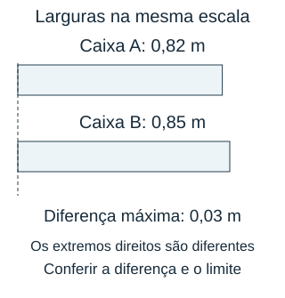

**Descrição do recurso visual:** Duas barras alinhadas à esquerda representam as larguras A de 0,82 m e B de 0,85 m, na mesma escala de 280 pixels por metro. A largura de B é maior, mas a diferença não é escrita. A tolerância máxima de 0,03 m está indicada separadamente.

- **A)** Não; a diferença é 0,3 m.
- **B)** Sim; a diferença é 0,03 m.
- **C)** Sim; a diferença é 0,00 m.
- **D)** Não; a diferença é 0,07 m.

**Gabarito: B.** A diferença é 0,85−0,82=0,03 m, exatamente o limite permitido. No máximo inclui a igualdade.

**Distratores:**

- A: Confundir centésimos com décimos.
- C: Arredondar larguras cedo demais.
- D: Subtrair algarismos de ordens diferentes.

### MFC6-B1-I-ND-03 — Litros e mililitros no pedido

**Dificuldade:** media. **Habilidade:** Converter unidades e comparar demanda com disponibilidade após reserva.

Uma jarra precisa atender a um pedido em litros, mas seu conteúdo e sua reserva obrigatória estão indicados em mililitros. Observe a jarra graduada, o pedido e a indicação da reserva. O pedido pode ser atendido preservando a reserva?

**Descrição do recurso visual:** Jarra com escala auxiliar de zero a 1.000 mL, marcada a cada 200 mL. O nível de conteúdo está em 800 mL. Os 100 mL inferiores são hachurados como reserva obrigatória, dentro do conteúdo total. O pedido aparece separado como 0,75 L, e consta a equivalência 1 L = 1.000 mL. Não estão calculados o pedido em mililitros, a parte disponível ou a diferença.

- **A)** Sim; sobram 50 mL além da reserva.
- **B)** Não; faltam 500 mL.
- **C)** Não; faltam 50 mL.
- **D)** Sim; sobram 625 mL além da reserva.

**Gabarito: C.** O pedido é de 750 mL. Preservando 100 mL, só há 700 mL disponíveis. Faltam 50 mL; os 800 mL totais não estão todos livres para o pedido.

**Distratores:**

- A: Ignorar a reserva obrigatória.
- B: Converter litros incorretamente ou desalinhar a diferença.
- D: Converter 0,75 L em 75 mL.

### MFC6-B1-I-ND-04 — Valor que cruza a marca

**Dificuldade:** facil. **Habilidade:** Interpretar soma decimal e mudança de referência inteira.

Uma medição está abaixo de uma referência e será aumentada em uma quantidade conhecida. Observe a reta com a medição inicial, a referência e a indicação do aumento. Depois do aumento, ela ficará abaixo, exatamente na referência ou acima?

**Descrição do recurso visual:** Reta de 4,94 a 5,06, com marcas igualmente espaçadas a cada 0,02, incluindo a referência 5,00. Um ponto marca a medição inicial 4,98. Abaixo, uma seta isolada e o rótulo de aumento +0,04 indicam a mudança, sem marcar a posição final ou calcular o excedente.

- **A)** Exatamente na referência.
- **B)** Abaixo, por 0,02.
- **C)** Acima, por 0,04.
- **D)** Acima, por 0,02.

**Gabarito: D.** 4,98+0,04=5,02. O novo valor fica 0,02 acima de cinco; o transporte dos centésimos altera a parte inteira.

**Distratores:**

- A: Ignorar os dois centésimos que ultrapassam.
- B: Manter a posição inicial abaixo da referência.
- C: Tomar todo o aumento como excedente.

### MFC6-B1-I-ND-05 — Escala que arredonda ao décimo

**Dificuldade:** media. **Habilidade:** Inferir intervalo de medições por arredondamento decimal.

Um termômetro arredonda leituras para o décimo mais próximo, subindo quando o centésimo é cinco ou maior. Observe o visor e a escala decimal. Qual leitura real poderia ter produzido a temperatura mostrada?

**Descrição do recurso visual:** Visor mostrando 23,4 °C. Uma escala neutra de 23,30 a 23,50 tem marcas uniformes a cada 0,01 e rótulos em 23,30, 23,35, 23,40, 23,45 e 23,50. A regra informa arredondamento ao décimo mais próximo, subindo quando o centésimo é cinco ou maior. Não há faixa de aceitação destacada nem pontos das alternativas posicionados.

- **A)** 23,38 °C.
- **B)** 23,34 °C.
- **C)** 23,45 °C.
- **D)** 23,51 °C.

**Gabarito: A.** O visor 23,4 representa leituras desde 23,35, inclusive, até antes de 23,45. Entre as opções, 23,38 está nessa faixa. 23,45 já aparece como 23,5.

**Distratores:**

- B: Incluir valor que arredonda para 23,3.
- C: Incluir o extremo superior que sobe ao próximo décimo.
- D: Confundir proximidade com pertencimento à faixa.

### MFC6-B1-I-ND-06 — Custo por distância com taxa fixa

**Dificuldade:** media. **Habilidade:** Modelar custo com parcela fixa e taxa decimal por unidade.

Um serviço de transporte de materiais cobra uma taxa fixa mais um valor por quilômetro. Observe o esquema da cobrança e o percurso indicado. Qual custo corresponde a esse percurso?

**Descrição do recurso visual:** Um bloco de taxa fixa mostra R$ 4,50, cobrado uma única vez. Um sinal de adição o separa da cobrança de R$ 1,20 por quilômetro. O percurso de 2,5 km aparece dividido em dois trechos de 1 km e um de meio quilômetro; o último tem metade da largura dos demais. Nenhum custo variável ou total está calculado.

- **A)** R$ 3,00.
- **B)** R$ 7,50.
- **C)** R$ 14,25.
- **D)** R$ 8,20.

**Gabarito: B.** O trecho variável custa 1,20×2,5=3,00 reais. Somando 4,50, são 7,50 reais. A taxa fixa não é multiplicada pela distância.

**Distratores:**

- A: Omitir taxa fixa.
- C: Multiplicar também a taxa fixa pela distância.
- D: Somar taxa, preço unitário e distância como grandezas iguais.

### MFC6-B1-I-ND-07 — A prateleira e a folga

**Dificuldade:** media. **Habilidade:** Somar medições de precisões diferentes e conferir reserva mínima.

Uma prateleira precisa de uma folga total mínima além da soma das larguras de três caixas. Observe a prateleira e as caixas, desenhadas na mesma escala, e a folga mínima exigida. As três caixas cabem respeitando a folga?

**Descrição do recurso visual:** Prateleira de 0,85 m e três caixas lado a lado de 0,24 m, 0,315 m e 0,28 m, todas na escala de 320 pixels por metro e com origem comum à esquerda. As caixas ficam contíguas, sem intervalos desenhados entre elas. Linhas projetam o extremo do conjunto e o da prateleira. A folga mínima é 0,01 m; a folga real aparece como interrogação.

- **A)** Não; faltam 0,015 m.
- **B)** Sim; sobram 0,15 m.
- **C)** Sim; a folga é 0,015 m.
- **D)** Sim; sobram 0,035 m.

**Gabarito: C.** As caixas ocupam 0,24+0,315+0,28=0,835 m. Sobram 0,015 m, mais que a folga mínima de 0,01; cabem. Arredondar cada largura antes da soma pode falsear a conclusão.

**Distratores:**

- A: Inverter a diferença.
- B: Confundir milésimos com centésimos.
- D: Desalinhar casas na soma.

### MFC6-B1-I-ND-08 — Quanto de fio pode ser comprado?

**Dificuldade:** media. **Habilidade:** Interpretar divisão decimal como comprimento máximo sob orçamento.

Uma loja permite comprar qualquer comprimento de fio, cobrado proporcionalmente ao preço por metro, sem taxa extra. Observe o orçamento e o esquema que relaciona o comprimento ao preço. Qual é o maior comprimento que cabe no orçamento?

**Descrição do recurso visual:** Orçamento de R$ 9,00. Um segmento de referência tem comprimento de um metro e preço de R$ 2,40. Uma seta liga essa correspondência ao comprimento desconhecido que pode ser adquirido pelo orçamento, sem taxa extra. Não é desenhado um fio de comprimento final nem um total de metros calculado.

- **A)** 4 m.
- **B)** 3 m.
- **C)** 21,6 m.
- **D)** 3,75 m.

**Gabarito: D.** 9,00÷2,40=3,75 m. Quatro metros custariam 9,60 e excederiam o orçamento; comprar só três metros deixaria uma possibilidade de comprimento sem usar.

**Distratores:**

- A: Arredondar para cima apesar do orçamento.
- B: Truncar sem considerar venda fracionada.
- C: Multiplicar dinheiro por preço por metro.

### MFC6-B1-I-ND-09 — Mesma tinta, dois tamanhos

**Dificuldade:** dificil. **Habilidade:** Conciliar custo, quantidade discreta e volume exato.

Uma loja vende a mesma tinta em dois tamanhos de frasco. A compra deve ser feita em frascos inteiros, todos do mesmo tamanho: somente A ou somente B. O volume total adquirido precisa ser exatamente 2 litros, sem falta nem excedente. Observe as capacidades e os preços por frasco. Qual escolha atende ao pedido pelo menor preço?

**Descrição do recurso visual:** Um frasco A com capacidade de 0,5 L e preço de R$ 3,20; um frasco B com capacidade de 0,8 L e preço de R$ 4,80. Os corpos retangulares têm a mesma largura e alturas proporcionais às capacidades; pequenas tampas são símbolos de embalagem. O volume exigido é exatamente 2 L, em frascos inteiros de um único tamanho. Nenhuma quantidade de frascos a comprar está desenhada.

- **A)** Quatro frascos A: 2 L por R$ 12,80.
- **B)** Dois frascos B: 2 L por R$ 9,60.
- **C)** Três frascos B: exatamente 2 L por R$ 14,40.
- **D)** Dois frascos A: 2 L por R$ 6,40.

**Gabarito: A.** São quatro frascos A, total 2 L e 12,80 reais. Frascos B não podem fornecer exatamente 2 L em quantidade inteira: 2÷0,8=2,5 frascos. Apesar de B custar menos por litro, essa compra não permite abrir frascos.

**Distratores:**

- B: Supor que dois frascos de 0,8 somam dois litros.
- C: Ignorar excedente de 0,4 litro.
- D: Confundir meio litro com um litro.

### MFC6-B1-I-ND-10 — Passos de uma peça de precisão

**Dificuldade:** dificil. **Habilidade:** Selecionar aproximação permitida em uma escala discreta.

Uma máquina faz cortes somente nas marcas de uma escala com passo fixo. A peça pedida tem uma medida intermediária. Observe a reta decimal e a posição do pedido. Qual marca permitida fica mais perto da medida pedida?

**Descrição do recurso visual:** Reta decimal com marcas em 1,05, 1,10, 1,15 e 1,20 cm, igualmente espaçadas, com passo de 0,05 cm. Uma seta indica o pedido de 1,13 cm entre 1,10 e 1,15, a três quintos do intervalo. Rótulos de 18 pixels têm margem nas extremidades. Nenhuma marca permitida está selecionada como resposta.

- **A)** 1,10 cm.
- **B)** 1,15 cm.
- **C)** 1,13 cm.
- **D)** 1,20 cm.

**Gabarito: B.** As marcas vizinhas são 1,10 e 1,15. As distâncias ao pedido são 0,03 e 0,02, respectivamente. A marca 1,15 é a mais próxima; 1,13 não é múltipla do passo 0,05.

**Distratores:**

- A: Escolher sempre a marca inferior sem comparar distâncias.
- C: Ignorar a restrição das marcas.
- D: Pular a marca vizinha superior.

### MFC6-B1-I-ND-11 — Comparar sem antecipar arredondamentos

**Dificuldade:** dificil. **Habilidade:** Distinguir arredondamento por parcela e arredondamento do total.

Um orçamento soma três itens e arredonda somente o total para reais inteiros, com centavos a partir de 50 arredondando para cima. Observe as três etiquetas de preços e o esquema da regra. Qual valor inteiro deve ser divulgado?

**Descrição do recurso visual:** Três etiquetas de itens, cada uma com preço de R$ 4,49. Setas indicam primeiro somar para obter o total exato desconhecido e depois arredondar somente esse total. A regra mantém os reais quando os centavos vão de 00 a 49 e sobe um real quando vão de 50 a 99. Nenhum item arredondado, soma ou resultado final é apresentado.

- **A)** R$ 12,00.
- **B)** R$ 14,00.
- **C)** R$ 13,00.
- **D)** R$ 15,00.

**Gabarito: C.** O total exato é 13,47, que arredonda para 13 reais. Arredondar cada item para quatro antes da soma daria 12, que não é a regra combinada.

**Distratores:**

- A: Arredondar cada parcela primeiro.
- B: Arredondar qualquer parte decimal para cima.
- D: Arredondar cada item para cinco.

### MFC6-B1-I-ND-12 — Reserva mínima em uma medida

**Dificuldade:** dificil. **Habilidade:** Dividir uma disponibilidade decimal após retirar uma reserva.

Um rolo deve fornecer quatro tiras de igual tamanho, deixando uma sobra mínima de segurança. Observe o esquema do rolo, das tiras e da reserva mínima. Qual é o maior tamanho permitido de cada tira?

**Descrição do recurso visual:** Rolo inteiro de 3,50 m, representado por uma barra com quatro tiras iguais de comprimento desconhecido e uma faixa final de reserva mínima de 0,10 m. Todos os comprimentos usam a mesma escala de 80 pixels por metro. As tiras têm interrogações, sem valores numéricos ou comprimento disponível calculado. O esquema mostra a configuração com a reserva mínima.

- **A)** 0,875 m.
- **B)** 0,825 m.
- **C)** 3,4 m.
- **D)** 0,85 m.

**Gabarito: D.** Podem ser usados 3,40 m depois da reserva. Dividindo em quatro, cada tira mede até 0,85 m. Dividir 3,50 direto por quatro consumiria a sobra obrigatória.

**Distratores:**

- A: Ignorar reserva.
- B: Retirar a reserva duas vezes.
- C: Não repartir entre as quatro tiras.

### MFC6-B1-I-ND-13 — Quando dobrar não é somar um

**Dificuldade:** media. **Habilidade:** Combinar fator de escala, medidas decimais e margens mínimas.

Uma etiqueta tem largura de 1,25 cm. Ela será ampliada pelo fator 2 e precisa ficar em um espaço de 2,60 cm, deixando 0,10 cm livre de cada lado. A etiqueta ampliada cabe com as margens exigidas?

- **A)** Não; faltam 0,10 cm para preservar as duas margens.
- **B)** Sim; sobram 0,10 cm depois das duas margens.
- **C)** Cabe exatamente; a sobra de 0,10 cm é suficiente para as duas margens.
- **D)** Não; faltam 0,20 cm.

**Gabarito: A.** A ampliação produz 2,50 cm. As margens exigem mais 0,20 cm, totalizando 2,70 cm. O espaço tem 2,60 cm, então faltam 0,10 cm. Sem margens a etiqueta caberia, mas essa não é a condição do problema.

**Distratores:**

- B: Ignorar margens e usar só a sobra bruta.
- C: Reservar 0,10 no total, não em cada lado.
- D: Tomar o total das margens como déficit sem considerar a sobra bruta.

### MFC6-B1-I-ND-14 — Desvio para o lado certo

**Dificuldade:** facil. **Habilidade:** Interpretar sentido e unidade de uma correção decimal.

Uma peça deveria medir 2,00 cm, mas mede 2,04 cm. Para chegar à medida prevista, o que deve ser feito? Escolha a alternativa que responde à situação.

- **A)** Aumentar 0,04 cm.
- **B)** Reduzir 0,04 cm.
- **C)** Reduzir 0,4 cm.
- **D)** Reduzir 4 cm.

**Gabarito: B.** A peça está 0,04 cm maior. É preciso reduzir quatro centésimos de centímetro, não quatro décimos. O ajuste é −0,04 cm.

**Distratores:**

- A: Inverter o sentido do ajuste.
- C: Confundir centésimos e décimos.
- D: Ignorar a parte decimal.

### MFC6-B1-I-ND-15 — Distância com unidade trocada

**Dificuldade:** media. **Habilidade:** Verificar equivalência de medidas em unidades diferentes.

Um mapa informa 0,35 km e um aviso diz 350 m para o mesmo trajeto. Há contradição? Escolha a alternativa que responde à situação.

- **A)** Sim; o aviso mostra mil vezes a distância.
- **B)** Sim; 0,35 km são 35 m.
- **C)** Não; os dois indicam o mesmo trajeto.
- **D)** Sim; decimais não podem representar quilômetros.

**Gabarito: C.** Não: 0,35×1.000=350 m. Os registros usam unidades diferentes para a mesma distância. Comparar 0,35 diretamente com 350, sem converter, não faz sentido.

**Distratores:**

- A: Comparar só números, ignorando as unidades.
- B: Usar conversão por cem.
- D: Excluir parte de unidade do sistema de medidas.

### MFC6-B1-I-ND-16 — Comprar pelo peso, não pela embalagem

**Dificuldade:** media. **Habilidade:** Comparar preços unitários com massas decimais.

Duas embalagens do mesmo produto têm preço por quantidade. Uma tem 0,4 kg por R$ 6,00; outra 0,6 kg por R$ 8,40. Qual tem menor preço por quilograma? Escolha a alternativa que responde à situação.

- **A)** A: R$ 6,00/kg; B: R$ 8,40/kg.
- **B)** A: R$ 2,40/kg; B: R$ 5,04/kg.
- **C)** B: R$ 1,40/kg; A: R$ 1,50/kg.
- **D)** B: R$ 14,00/kg; A: R$ 15,00/kg.

**Gabarito: D.** A custa 6÷0,4=15 reais por kg; B custa 8,40÷0,6=14. A embalagem B é mais econômica por quantidade, apesar do preço individual maior.

**Distratores:**

- A: Comparar preços das embalagens como preços por quilograma.
- B: Multiplicar preço pela massa em vez de dividir.
- C: Deslocar a vírgula indevidamente na divisão.

### MFC6-B1-I-ND-17 — Somar leituras com unidades distintas

**Dificuldade:** media. **Habilidade:** Compatibilizar unidades antes de somar medidas.

Um laboratório usa 250 mL de líquido e depois mais 0,4 L. Qual é o total em litros? Escolha a alternativa que responde à situação.

- **A)** 0,65 L.
- **B)** 250,4 L.
- **C)** 2,9 L.
- **D)** 0,15 L.

**Gabarito: A.** 250 mL=0,25 L. Somando 0,4 L, obtém-se 0,65 L. Primeiro é necessário colocar os dados na mesma unidade.

**Distratores:**

- B: Somar sem converter unidade.
- C: Converter 250 mL em 2,5 L.
- D: Subtrair as parcelas em vez de somar.

### MFC6-B1-I-ND-18 — A igualdade perdida na cópia

**Dificuldade:** media. **Habilidade:** Avaliar efeito do arredondamento sobre uma medida.

Uma planilha registra 6,08 m. Ao copiar para um campo com uma casa decimal, o operador arredonda ao décimo mais próximo. Quanto a nova indicação difere da original? Escolha a alternativa que responde à situação.

- **A)** Fica 0,08 m menor.
- **B)** Fica 0,02 m maior.
- **C)** Fica 0,2 m maior.
- **D)** Não muda o valor.

**Gabarito: B.** 6,08 arredonda para 6,1. A diferença é 6,10−6,08=0,02 m a mais. Reduzir casas decimais não é simplesmente cortar o último algarismo.

**Distratores:**

- A: Truncar a indicação para seis.
- C: Confundir centésimos com décimos.
- D: Confundir retirar algarismo significativo com retirar zero final.

### MFC6-B1-I-ND-19 — Uma taxa muda a escolha

**Dificuldade:** dificil. **Habilidade:** Comparar tarifa variável e tarifa com taxa fixa em um período.

Um serviço A cobra R$ 1,80 por hora; outro B cobra R$ 1,50 por hora mais taxa fixa de R$ 2,00. Para seis horas, qual é o mais barato e por quanto? Escolha a alternativa que responde à situação.

- **A)** B, por R$ 1,80.
- **B)** B, por R$ 0,20.
- **C)** A, por R$ 0,20.
- **D)** A, por R$ 2,00.

**Gabarito: C.** A custa 10,80 reais; B custa 9+2=11. A economiza 0,20 real. O preço por hora mais baixo de B não garante custo final mais baixo.

**Distratores:**

- A: Ignorar taxa fixa de B.
- B: Inverter o plano mais econômico.
- D: Tomar a taxa inteira como diferença sem comparar preços por hora.

### MFC6-B1-I-ND-20 — Tolerância após um arredondamento

**Dificuldade:** dificil. **Habilidade:** Cruzar arredondamento decimal e limite de erro admissível.

Uma leitura real é 1,246 m. Um relatório guarda apenas centésimos, arredondando ao mais próximo. A tolerância admite diferença de no máximo 0,005 m entre valor real e guardado. O relatório atende? Escolha a alternativa que responde à situação.

- **A)** Não; a diferença é 0,006 m.
- **B)** Não; a diferença é 0,04 m.
- **C)** Sim; a diferença é zero.
- **D)** Sim; a diferença é 0,004 m.

**Gabarito: D.** O valor guardado é 1,25 m; a diferença é 0,004 m. Como 0,004≤0,005, atende. Truncar em 1,24 produziria diferença 0,006, fora da tolerância.

**Distratores:**

- A: Truncar em vez de arredondar.
- B: Comparar casas decimais de ordens diferentes.
- C: Tratar aproximação como valor exato.

